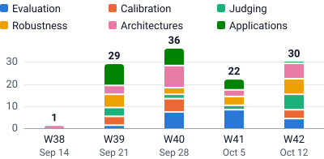

# Awesome Jev

[](https://awesomejev.github.io/) [](https://github.com/reacher-z/Awesome-Jev/actions/workflows/ci.yml) [](LICENSE)

A curated list of **Jev and typed decision model** papers, models, datasets, evaluation tools, and practical guides.

**[Main repository](https://github.com/reacher-z/Awesome-Jev)** · [Website](https://awesomejev.github.io/) · [Papers](https://awesomejev.github.io/papers/) · [Research guide](https://awesomejev.github.io/guide/) · [New resources](https://awesomejev.github.io/discoveries/) · [Model directory](https://awesomejev.github.io/models/) · [Tool directory](https://awesomejev.github.io/tools/) · [Research topics](https://awesomejev.github.io/topics/) · [中文](README.zh-CN.md) · [Survey](docs/survey.md) · [BibTeX](references.bib) · [Contribute](CONTRIBUTING.md)

Independent community project; not affiliated with TypeSafe AI. Last curated: **2026-10-18**. The website is published from [AwesomeJev.github.io](https://github.com/AwesomeJev/AwesomeJev.github.io).

The [new-resource directory](https://awesomejev.github.io/discoveries/) adds hundreds of projects, datasets, model cards, guides and research papers, with explicit screening levels and relationship labels. [Review the expansion and counting method](docs/expansion-2026-10-16.md); abstract checks are not full-paper reviews.

## Start here

| Your task | Start with | What you get |
| :--- | :--- | :--- |
| Understand the research | [Papers](https://awesomejev.github.io/papers/) · [Survey](docs/survey.md) | Versioned studies, contributions and evidence limits. |
| Compare models | [Model directory](https://awesomejev.github.io/models/) | Publisher, declared license and documented scope. |
| Build an integration | [Tool directory](https://awesomejev.github.io/tools/) · [Quick start](#quick-start) | Implementation entry points and a minimal API example. |
| Investigate a question | [Research topics](https://awesomejev.github.io/topics/) · [Guide](https://awesomejev.github.io/guide/) | Source-backed explanations and evaluation protocols. |
| Explore more sources | [New resources](https://awesomejev.github.io/discoveries/) | Broader projects, datasets and background research with screening labels. |

## What's new

The ten most recent studies by linked-version date, newest first. [Papers](#papers) has the full list; [New resources](https://awesomejev.github.io/discoveries/) has broader screened sources.

- 2026-10-15 · v1 · [Qwen-Audio-Jev: A Unified Interface for Audio Decisions](https://arxiv.org/abs/2610.21614v1) — in [Architectures, memory, and multimodality](#architectures-memory-and-multimodality)
- 2026-10-15 · v1 · [JevAgentHarness: Benchmarking, Deploying and Training Decision Models That Share Control with LLMs](https://arxiv.org/abs/2610.21412v1) — in [Judging and selective automation](#judging-and-selective-automation)
- 2026-10-15 · v1 · [Jev-LiteMAS: Separating Decisions from Generation in Multi-Agent Workflows](https://arxiv.org/abs/2610.21411v1) — in [Judging and selective automation](#judging-and-selective-automation)
- 2026-10-15 · v1 · [System1-Arena: Which Decisions Can Be Left to System 1?](https://arxiv.org/abs/2610.21244v1) — in [Evaluation and benchmarking](#evaluation-and-benchmarking)
- 2026-10-15 · v3 · [Jev for Scientific Decisions: Evaluating Semantic Choices and Their Consequences](https://arxiv.org/abs/2609.24965v3) — in [Applications and domain studies](#applications-and-domain-studies)
- 2026-10-14 · v1 · [Prune the Summary, Not the History: Source-Judged Compaction for Long-Horizon Agents](https://arxiv.org/abs/2610.20927v1) — in [Architectures, memory, and multimodality](#architectures-memory-and-multimodality)
- 2026-10-14 · v1 · [From Detection to Decision: Calibration and Deferral for Prompt-Injection Detection](https://arxiv.org/abs/2610.20907v1) — in [Robustness and security](#robustness-and-security)
- 2026-10-14 · v1 · [Verdict: Encode Once, Decide Many](https://arxiv.org/abs/2610.20778v1) — in [Architectures, memory, and multimodality](#architectures-memory-and-multimodality)
- 2026-10-14 · v1 · [Calibration and Risk-Budgeted Decisions with System One Models](https://arxiv.org/abs/2610.19811v1) — in [Probability calibration and coherence](#probability-calibration-and-coherence)
- 2026-10-14 · v1 · [Selective Reasoning for Typed Decision Models: When to Start, Read, and Stop](https://arxiv.org/abs/2610.19644v1) — in [Judging and selective automation](#judging-and-selective-automation)

## Contents

- [What's new](#whats-new)
- [Overview and official resources](#overview-and-official-resources)
- [Papers](#papers)
  - [Evaluation and benchmarking](#evaluation-and-benchmarking)
  - [Probability calibration and coherence](#probability-calibration-and-coherence)
  - [Judging and selective automation](#judging-and-selective-automation)
  - [Robustness and security](#robustness-and-security)
  - [Architectures, memory, and multimodality](#architectures-memory-and-multimodality)
  - [Applications and domain studies](#applications-and-domain-studies)
- [Models](#models)
- [Benchmarks and evaluation tools](#benchmarks-and-evaluation-tools)
- [Datasets](#datasets)
- [SDKs and integrations](#sdks-and-integrations)
- [Practical guides](#practical-guides)
- [Foundations and related research](#foundations-and-related-research)
- [Quick start](#quick-start)
- [Source audit](#source-audit)
- [Contributing](#contributing)
- [License](#license)

## Overview and official resources

TypeSafe's Jev accepts a state and typed questions, returning decisions and probabilities for application code. Schema validity, semantic correctness, and probability calibration are separate properties.

- [Introducing System One Models & Jev](https://typesafe.ai/blog/introducing-system-one-models-and-jev) — launch article and provider claims.
- [Documentation](https://docs.typesafe.ai/introduction) · [API](https://docs.typesafe.ai/api) · [Models and versions](https://docs.typesafe.ai/models).
- [Choice](https://docs.typesafe.ai/primitives/choice) — choose from up to 255 options; returns a distribution and confidence.
- [Score](https://docs.typesafe.ai/primitives/score) — a probability-weighted position on descriptive, ordered levels.
- [Noul](https://docs.typesafe.ai/primitives/noul) — the probability of yes; no separate confidence field.
- [Confidence](https://docs.typesafe.ai/confidence) · [Jev 1.13 limitations](https://docs.typesafe.ai/model-jaggedness/jev-1.13).
- [Experimental images](https://docs.typesafe.ai/images) · [Box](https://docs.typesafe.ai/primitives/box) — opt-in capabilities; Box requires Jev 1.14.
- [Jev 1.14 release notes](https://typesafe.ai/blog/jev-1-14) — 2026-10-14 provider post: `jev-1.14.0` under `jev-preview`, opt-in header flags for images and long context, and Box for 1.14 only. Its intelligence chart is provider-run and, by its own account, likely biased toward TypeSafe's models.

On **2026-10-17**, `jev-latest` points to `jev-1.13.0` and `jev-preview` to `jev-1.14.0`; the release notes say `jev-latest` moves to `jev-1.14.0` about a week after 2026-10-14. Pin the version for evaluation. See the [survey](docs/survey.md) for the conceptual distinctions and evaluation protocol.

## Papers

All 82 direct studies below are **arXiv preprints**. Dates identify the linked, reviewed version, not necessarily the first submission. Results are author-reported; this project has not reproduced their experiments. Titles that contain speed or cost claims retain the authors' wording. A dash in the Artifacts column means none is linked. [Bibliography](references.bib) · [Evidence comparison](docs/survey.md)

<!-- papers-by-week: generated by scripts/build_site.mjs from site/catalog.mjs -->
<p><picture>
  <source media="(prefers-color-scheme: dark)" srcset="assets/papers-by-week-dark.svg">
  
</picture><br><sub>Papers per week of first arXiv submission, by theme. ISO weeks, dated by their Monday. Counts cover this collection, not the whole literature.</sub></p>

<details><summary>Show the numbers</summary>

<table><thead><tr><th scope="col">Theme</th><th scope="col">W38</th><th scope="col">W39</th><th scope="col">W40</th><th scope="col">W41</th><th scope="col">W42</th><th scope="col">Total</th></tr></thead><tbody><tr><th scope="row">Evaluation</th><td>0</td><td>1</td><td>5</td><td>7</td><td>4</td><td>17</td></tr><tr><th scope="row">Calibration</th><td>0</td><td>1</td><td>4</td><td>0</td><td>3</td><td>8</td></tr><tr><th scope="row">Judging</th><td>0</td><td>4</td><td>1</td><td>2</td><td>4</td><td>11</td></tr><tr><th scope="row">Robustness</th><td>0</td><td>6</td><td>2</td><td>2</td><td>5</td><td>15</td></tr><tr><th scope="row">Architectures</th><td>1</td><td>3</td><td>7</td><td>3</td><td>6</td><td>20</td></tr><tr><th scope="row">Applications</th><td>0</td><td>8</td><td>1</td><td>1</td><td>1</td><td>11</td></tr><tr><th scope="row">Total</th><td>1</td><td>23</td><td>20</td><td>15</td><td>23</td><td>82</td></tr></tbody></table>

</details>
<!-- /papers-by-week -->

### Evaluation and benchmarking

| Date&nbsp;·&nbsp;version | Paper | Key finding | Artifacts |
| :--- | :--- | :--- | :--- |
| 2026-10-15<br>v1 | [System1-Arena: Which Decisions Can Be Left to System 1?](https://arxiv.org/abs/2610.21244v1)<br>Chen et al. | Matched requests and closed-loop tasks for decision and reasoning models. | [Code](https://github.com/TianyuCodings/S1-Arena) · [Public requests](https://huggingface.co/datasets/C-Tianyu/S1-Arena) |
| 2026-10-14<br>v1 | [Typed Decision Models on Tabular Data](https://arxiv.org/abs/2610.19536v1)<br>Zhang, Ye & Zha | Tests classification and verification under content-preserving table rewrites across three task families; confidence can flag instability without proving correctness. | Dedicated study code was not verified. |
| 2026-10-13<br>v1 | [Jev-ToM: Evaluating Theory of Mind in Typed Decision Models](https://arxiv.org/abs/2610.18610v1)<br>Chung et al. | On 11,117 English Theory of Mind questions from nine benchmarks, Jev reaches 73.2% source-balanced accuracy and ranks first or second in all six capability groups among twelve typed and generative models; confidence-based selection is benchmark-dependent, and supplied reasons repair or overturn answers depending on how they are attached. | [Questions, answer keys and saved predictions](https://github.com/HKUST-KnowComp/Jev-ToM); source-benchmark terms apply. |
| 2026-10-13<br>v1 | [Reading Right, Acting Wrong: Diagnosing Decision Failures of System One Models in Agent Loops](https://arxiv.org/abs/2610.18579v1)<br>Li, Krishnan & Padman | Pairs factual probes with action choices to diagnose decision failures. | [Author dashboard](https://yubol-bobo.github.io/System_one_model_evaluation/) |
| 2026-10-12<br>v2<br>first submitted 2026-10-02 | [General Decision Models: Benchmarking and Insights Beyond Jev](https://arxiv.org/abs/2610.03935v2)<br>Duan et al. | Bilingual decision evaluation and reliability in multi-step systems. | [Training and inference code](https://github.com/amazingljy1206/SII-Decision) · [Evaluation data](https://huggingface.co/datasets/carlosxiang/JEVal) |
| 2026-10-12<br>v3<br>first submitted 2026-10-05 | [GraphDecisionBench: Benchmarking System One Models on Graph Tasks](https://arxiv.org/abs/2610.06354v3)<br>Yang, Zhang & Zhao | Compares graph decisions across fourteen model-interface configurations; local adjacency, graph-text evidence use and sequential solution quality are separate capabilities. | [Code and aggregate results](https://github.com/VictorYXL/GraphDecisionBench) |
| 2026-10-09<br>v1 | [Does System One Transfer? Calibrated Typed-Decision Models, Label Budgets, and Translation for Indonesian Regional Languages](https://arxiv.org/abs/2610.14112v1)<br>Fadli, Rusdah, Utami & Amana | Tests Jev and multilingual Laya on Indonesian regional-language tasks; stable expected calibration error can coexist with worse error ranking, while human translation, label budgets and cascade choices change comparisons. | [Author-linked study materials](https://github.com/tnromy/evaluating-system-one-models-for-indonesian-regional-languages) |
| 2026-10-09<br>v1 | [When Faster Decisions Do Not Make Better Agents: An Empirical Study of Jev in Agent Workflows](https://arxiv.org/abs/2610.13092v1)<br>Ling, Yu, Chen & Fang | Jev cut decision cost and latency for five agents in ALFWorld and AndroidWorld (4,500 runs), but two mobile agents lost more success, extra reasoning and interactions absorbed the savings, and cost per success rose for one agent. | — |
| 2026-10-09<br>v2<br>first submitted 2026-10-08 | [TypedBench: A Benchmark for Calibration, Framing Sensitivity, and Cost in System One Decision Models](https://arxiv.org/abs/2610.11392v2)<br>Sharma, Duncan, Caron & Vollmer | The hosted model is wording-sensitive and underconfident, and under asymmetric costs acting on its probabilities can cost more than taking its top answer; synthetic policy-labelled suites also report paraphrase ranges and calibration against a finite-sample noise floor. | — |
| 2026-10-08<br>v1 | [Specialized Decision Models vs. General-Purpose LLMs: Benchmarking Jev Across Knowledge, Reasoning, and Multilingual Tasks](https://arxiv.org/abs/2610.11978v1)<br>Li et al. | Knowledge, reasoning and multilingual multiple-choice evaluation of Jev; reported rankings and mathematical weaknesses apply to the selected models and benchmarks. | — |
| 2026-10-06<br>v2<br>first submitted 2026-09-29 | [Benchmarking System One decision models against trained classifiers and language models for automated decision gates](https://arxiv.org/abs/2610.00346v2)<br>Rafe & Das | A common-request harness compares typed decision models, generative readouts and trained classifiers; accuracy, selective coverage and out-of-scope acceptance depend on label access and task. | — |
| 2026-10-06<br>v2<br>first submitted 2026-10-05 | [JEV versus LLMs: Accuracy, Cost and Calibration on Seven Political Science Replications](https://arxiv.org/abs/2610.06625v2)<br>Denney & DiGiuseppe | Seven domain-specific replications; accuracy, cost, and calibration. | — |
| 2026-10-05<br>v1 | [SoK: Semantic Decision Engines in Network Control Loops](https://arxiv.org/abs/2610.06425v1)<br>Li et al. | Surveys semantic engines in network control loops; separates valid decisions, action feasibility, service checks and deadline attainment, with bounded event-model tests rather than production validation. | — |
| 2026-10-03<br>v2<br>first submitted 2026-09-28 | [Calibrated to Whom? Persona and Language Effects on Cultural Values in JEV](https://arxiv.org/abs/2609.36399v2)<br>Asseri & Asseri | English/Arabic persona-conditioned Jev survey audit; the effects concern simulated respondents in one model, not measurements of real populations. | — |
| 2026-10-01<br>v1 | [HakemBench: A Turkish Benchmark of Typed Decisions](https://arxiv.org/abs/2610.02293v1)<br>Teke | Turkish typed-decision evaluation reports decision quality, Brier-based probability quality and risk–coverage alongside input probes; most labels are AI-derived, and the lab’s model used feedback from earlier test results. | [Benchmark code and data](https://github.com/ufakai/hakembench) · [Model implementation](https://github.com/ufakai/ufakzeka-karar) · [Checkpoint](https://huggingface.co/ufakai/ufakzeka-karar) |
| 2026-09-29<br>v1 | [Evaluating and Benchmarking the System One Model Jev](https://arxiv.org/abs/2609.37647v1)<br>Deußer, Sparrenberg & Sifa | Classification and decision evaluation across 37 datasets. | [Code](https://github.com/AppliedMachineLearning-Lab/jev-benchmarking) |
| 2026-09-26<br>v1 | [Typed Decision Models: An Early Evidence Audit and Evaluation Checklist](https://arxiv.org/abs/2609.32160v1)<br>Tang & Zheng | Evidence mapping and an evaluation checklist for typed decisions. | — |

### Probability calibration and coherence

| Date&nbsp;·&nbsp;version | Paper | Key finding | Artifacts |
| :--- | :--- | :--- | :--- |
| 2026-10-14<br>v1 | [Calibration and Risk-Budgeted Decisions with System One Models](https://arxiv.org/abs/2610.19811v1)<br>Messoudi & Mansar | Jev and other System One models make binary allow/block or retain/discard decisions without human deferral; across six moderation, safety and reranking datasets, naive threshold selection exceeds the target risk in about half the settings, against 7.8% for Learn Then Test. | — |
| 2026-10-14<br>v1 | [Are AI Decision Models Biased? A Case Study of Jev](https://arxiv.org/abs/2610.19619v1)<br>Imperatrice, Kameneva, Greenberg & Romano | In 41,500 responses Jev's selected answers look largely unbiased, but its judgments shift with irrelevant numbers and option order, and several bias manipulations move its probabilities even when the answer stays the same; on 30 adapted conjunction tasks it violates the conjunction rule in 54% of 15,000 responses. | — |
| 2026-10-14<br>v2<br>first submitted 2026-09-30 | [More Choices, Fewer Decisions: Ordinal-Scale Bias in JEV-like Direct-Decision Models](https://arxiv.org/abs/2609.38827v2)<br>Gao et al. | Audits ordinal label underuse across selected decision models; finer scales increase compression, while accuracy, final-label utilization and averaged candidate probabilities remain distinct measures. | [Anonymous code artifact](https://anonymous.4open.science/r/jev_ordinal_scale_bia/); anonymous mirror, expires 2027-04-10. |
| 2026-10-12<br>v1 | [Does a Hosted Decision Model Respect Irrelevant Alternatives? A Pre-Registered Test of Option-Set Dependence in Jev](https://arxiv.org/abs/2610.16655v1)<br>Rajput, Chauhan & Kosaraju | Adding an irrelevant option shifts jev-1.13.0’s gold-versus-rival log-odds, more so as options grow, so its probabilities are relative to the option list; independent yes/no scoring removes this but is less accurate (pre-registered, 299,463 calls, three datasets). | — |
| 2026-10-01<br>v1 | [Beyond Answer Confidence: A Controlled Audit of Self-Knowledge in a Black-Box Decision Model](https://arxiv.org/abs/2610.01006v1)<br>Shankaranarayana, Runje & Jannink | Controls information and surface cues to distinguish Jev answer confidence from self-knowledge; black-box behavior does not establish access to an internal knowledge state. | [Code](https://github.com/Syntheme/beyond-answer-confidence) |
| 2026-09-30<br>v1 | [AnyJev Technical Report](https://arxiv.org/abs/2610.00831v1)<br>Zhang et al. | Training-free probability readout with label-prior and option-order correction. | [Code](https://github.com/nokia-applied-research/AnyJev) |
| 2026-09-28<br>v1 | [Jev thinks “I don’t know”, but doesn’t say it: Introducing Sys1Cal-v1 Dataset for Probability Calibration](https://arxiv.org/abs/2609.35342v1)<br>Porcedda | Controlled probability targets for testing calibration. | [Code and synthetic benchmark](https://github.com/little-g-ai/Sys1Cal-v1) |
| 2026-09-27<br>v1 | [Beyond Calibration: Do a Typed-Decision Model’s Probabilities Obey the Probability Axioms?](https://arxiv.org/abs/2609.33209v1)<br>Li, He & Li | Logical coherence between related probability questions. | [Code and recorded calls](https://github.com/bro789/typed-decision-coherence) |

### Judging and selective automation

| Date&nbsp;·&nbsp;version | Paper | Key finding | Artifacts |
| :--- | :--- | :--- | :--- |
| 2026-10-15<br>v1 | [JevAgentHarness: Benchmarking, Deploying and Training Decision Models That Share Control with LLMs](https://arxiv.org/abs/2610.21412v1)<br>Zhu et al. | Per-choice thresholds for sharing agent control between decision models and LLMs. | [Code](https://github.com/JevAgentHarness/JevAgentHarness) |
| 2026-10-15<br>v1 | [Jev-LiteMAS: Separating Decisions from Generation in Multi-Agent Workflows](https://arxiv.org/abs/2610.21411v1)<br>Wang, Zhou, Lou & Li | Routes expert handoffs and screens artifacts before generative re-review; lower generative-token use depends on the workload, with fixed expert pools and savings that shrink as more artifacts need repair. | Code not verified |
| 2026-10-14<br>v1 | [Selective Reasoning for Typed Decision Models: When to Start, Read, and Stop](https://arxiv.org/abs/2610.19644v1)<br>Zheng & Chen | Gates reasoning start, candidate-answer reading and generation stopping; evidence is limited to a frozen Qwen backbone and three task families. | [Code and saved measurements](https://github.com/binzheng-joey/selective-reasoning); README inspected, not executed. |
| 2026-10-13<br>v3<br>first submitted 2026-09-24 | [Decision Models vs. LLMs as Rubric Judges: Cheaper, Faster, and Wrong in the Same Places](https://arxiv.org/abs/2609.29769v3)<br>Rao & Callison-Burch | Rubric judging, correlated errors, and limits to cascade gains. | — |
| 2026-10-13<br>v1 | [Judges Follow the Reference: The Derivation Gap in Verifying Tool-Call Arguments](https://arxiv.org/abs/2610.18497v1)<br>Ma et al. | Tool-argument judges including Jev reject some correct derived values without visible references; model-generated references are evaluated on three benchmarks. | [Code](https://github.com/SarielMa/DeRef_release) · [Evaluation data](https://huggingface.co/datasets/lm2445/DeRef); model outputs are not included. |
| 2026-10-11<br>v1 | [Suggested Is Not Superseded: A Pre-Registered Evaluation of a System-One Model as a Memory-Retirement Gate](https://arxiv.org/abs/2610.15710v1)<br>Chen & Le | Jev memory-retirement evaluation separates confirmed updates from suggestions; mixed LLM/human labels, shared errors and selection on a small development set constrain cascade claims. | — |
| 2026-10-10<br>v2<br>first submitted 2026-10-06 | [JevCascade: Readout Stability and Inference-Time Compute Allocation for Prefill-Only Decision Models](https://arxiv.org/abs/2610.07716v2)<br>Li & Chen | Candidate-menu interventions and confidence cascades; ranking stability does not establish probability calibration. | [Code and data](https://github.com/rlisml/jev-cascade) |
| 2026-10-09<br>v5<br>first submitted 2026-09-22 | [JEV-as-a-Judge: Accept When Confident, Escalate When Unsure](https://arxiv.org/abs/2609.26550v5)<br>Li, Miao, Krishnan & Padman | Confidence-gated escalation from Jev to a reasoning judge. | [Project page](https://yubol-bobo.github.io/jev-as-a-judge/) |
| 2026-09-28<br>v1 | [JEV as a Judge for Agent Trace Security: An Empirical Comparison with Generative LLM Judges](https://arxiv.org/abs/2609.34862v1)<br>Wang & Gao | Compares Jev and generative judges on retrospective agent-trace risk classification; dataset rankings vary, and successful-call latency and valid-judgment cost must be read with coverage. | — |
| 2026-09-25<br>v1 | [LAVOIR: Teaching a Single-Pass Decision Encoder When and What to Ask with Amortized Value of Information](https://arxiv.org/abs/2609.30706v1)<br>Yilmaz, Tasdemir & Gozay | Estimates the value of asking for missing information alongside decision probabilities. | [Code](https://github.com/moganai/lavoir) · [Checkpoint](https://huggingface.co/moganai/lavoir) |
| 2026-09-22<br>v1 | [REFLEX with Jev for Efficient Selective Control in LLM Agents](https://arxiv.org/abs/2609.26532v1)<br>Wu & Lim | Confidence-gated Jev control with LLM fallback; gains depend on action alternatives and baseline routing. | — |

### Robustness and security

| Date&nbsp;·&nbsp;version | Paper | Key finding | Artifacts |
| :--- | :--- | :--- | :--- |
| 2026-10-14<br>v1 | [From Detection to Decision: Calibration and Deferral for Prompt-Injection Detection](https://arxiv.org/abs/2610.20907v1)<br>Lan, Kaul, Pandurangan & Sanyal | On 47,611 held-out prompt-injection examples, Jev ranks second in AUROC after an LLM judge, its native probabilities do not consistently beat post-hoc calibrated classifiers, and a 1% false-negative target forces over 91.8% escalation in every gate-reviewer system. | — |
| 2026-10-13<br>v1 | [DecisionRobust: Benchmarking Robustness for JEV Style Decision Models Across Text and Vision](https://arxiv.org/abs/2610.19118v1)<br>Lan et al. | Text and vision attacks with label-validity checks and held-out models. | [Code](https://github.com/Yifan-Lan/DecisionRobust) · [Benchmark](https://yifan-lan.github.io/DecisionRobust/) |
| 2026-10-13<br>v1 | [Nudge the Judge: Uncovering Program Decision Hijacking in Real-World Jev Applications](https://arxiv.org/abs/2610.18612v1)<br>Luo et al. | JevProbe traces attacker-controlled context into the decisions that 228 popular Jev applications act on; in 2,273 curated cases (at most ten per app, flips selected first, so not an unbiased sample) 81.5% flip, 98.6% of flips with potential downstream security impact, and existing defenses offer limited protection. | [Code and JevProbeBench](https://github.com/xiaoxiaohg8d/JevProbe-); README inspected, not executed. |
| 2026-10-13<br>v1 | [Consider, Then Choose: Order-Invariant Decisions in System One Models](https://arxiv.org/abs/2610.18233v1)<br>Huang, Teng, Deng & An | Runoff scores options individually, then balances finalist positions; order invariance assumes deterministic responses and a unique ranking, and does not resolve option-name bias or guarantee more accurate decisions. | Code not verified |
| 2026-10-13<br>v1 | [Same Attack, Different Judge: A First Controlled Adversarial Comparison of Jev, LLM Judges, and Purpose-Built Safety Classifiers](https://arxiv.org/abs/2610.17820v1)<br>Li, Huang, Zhang & Liu | Controlled attacks against decision models and safety classifiers. | — |
| 2026-10-08<br>v3<br>first submitted 2026-09-22 | [Type-Safe Is Not Error-Free: Typed Decision Models Follow the Option Name, Not the Definition Bound to It](https://arxiv.org/abs/2609.26758v3)<br>Sun, Xu, Shi & Yang | Tests whether option names override assigned definitions despite structurally valid outputs. | — |
| 2026-10-08<br>v1 | [One Word Opens the Gate: The Option-Channel Attack on Typed Decision Models as Agent Guardrails](https://arxiv.org/abs/2610.12292v1)<br>Azizi, Baghaei Potraghloo & Pedram | Tests option-channel attacks on seven open-weight models; reversed decisions can remain confident. The reported experiments do not test hosted Jev. | [Code and cached analyses](https://github.com/ArminAzizi98/option-channel-attack) |
| 2026-10-08<br>v2<br>first submitted 2026-09-24 | [JevOut: Natural Context Can Flip Decision Models](https://arxiv.org/abs/2609.30243v2)<br>Xu et al. | Optimizes context additions around unchanged questions and options in four decision systems; results concern initially correct decisions, and human validity checks cover a sampled subset of successful attacks. | [Code](https://github.com/xzx34/JevOut) |
| 2026-10-06<br>v1 | [Same-Number Citation Swaps: Stress-Testing Jev as a Financial Evidence Judge](https://arxiv.org/abs/2610.08675v1)<br>Xu et al. | Same-number citation swaps probe financial-evidence verification; rejecting wrong roles trades off with accepting equivalent support in a constructed test. This does not estimate population-wide financial accuracy. | — |
| 2026-10-04<br>v1 | [Hidden Risks of Jev: An Empirical Study of Security, Privacy, and Dual Use](https://arxiv.org/abs/2610.04985v1)<br>Wang et al. | Tests the official Jev API and the local NanoJev for prompt injection, data-poisoning backdoors, membership, attribute and knowledge inference, and dual use in four detection tasks; the authors report Jev remains vulnerable to the examined threats. | [Partial code: NanoJev backdoor experiment](https://github.com/shihe98/Security_Privacy_Jev); no license declared. |
| 2026-10-03<br>v3<br>first submitted 2026-09-27 | [Evaluating System One Models for Agent Security Decisions: Reliability, Calibration, and Selective Automation](https://arxiv.org/abs/2609.33401v3)<br>Liu | Confident security errors and selective automation under asymmetric risks. | [Code and saved-result analyses](https://github.com/yxsec/system-one-security-eval) |
| 2026-10-01<br>v1 | [Labels Override Definitions in Jev-Style Typed Decision Models](https://arxiv.org/abs/2610.02586v1)<br>Azizi, Baghaei Potraghloo & Pedram | Studies option-label bias in open-weight decision models; prompt-rendering changes with fixed weights implicate the label/definition interface, without testing hosted Jev. | — |
| 2026-09-25<br>v1 | [JevAdvBench: A Benchmark and Black-Box Attacks for Reinforcement Learning for Calibrated Decisions Models](https://arxiv.org/abs/2609.31142v1)<br>Hu et al. | Adversarial edits compared with clean inputs and repeated-call variation. | [Code](https://github.com/JevAdvBench/JevAdvBench) · [Benchmark data](https://huggingface.co/datasets/Hangtao/JevAdvBench) |
| 2026-09-24<br>v1 | [Just Ask Jev: Reinforcement Learning for Calibrated Decisions as a Zero-Shot Detector of AI Alignment Failures](https://arxiv.org/abs/2609.29429v1)<br>Guo et al. | Benchmarks Jev alignment-failure detection while separating question wording from input context; benchmark-scorer labels dominate, and context gains often depend on fields encoding the label. | [Code and data](https://github.com/sumleo/RLCDAlignBench) |
| 2026-09-23<br>v1 | [Decision Hijacking: Prompt Injection Attacks on Jev's Typed Probabilistic Decisions](https://arxiv.org/abs/2609.28613v1)<br>Wu & Lim | Audits Jev injection on reconstructed InjecAgent cases, separating probability shifts from attacker-target selections; optimization results are checked on fresh calls, within this benchmark setting. | — |

### Architectures, memory, and multimodality

| Date&nbsp;·&nbsp;version | Paper | Key finding | Artifacts |
| :--- | :--- | :--- | :--- |
| 2026-10-15<br>v1 | [Qwen-Audio-Jev: A Unified Interface for Audio Decisions](https://arxiv.org/abs/2610.21614v1)<br>Fang et al. | An independent Jev-style decision head on Qwen-Audio-3.1-ASR-Flash-Next gives Choice, Noul and Score readouts over audio, reporting 84.06% on MMSU, a 6.50% speaker-verification equal error rate and about 20× faster inference than its own base model. | — |
| 2026-10-14<br>v1 | [Prune the Summary, Not the History: Source-Judged Compaction for Long-Horizon Agents](https://arxiv.org/abs/2610.20927v1)<br>Min & Chen | Uses Jev to prune summary entries lacking source support; reported gains concern success in all three runs on two benchmarks, while useful constraints can be discarded and sourced errors retained. | [Code](https://github.com/GuanghuiMin/sjc) · Requires separate benchmark environments and model API access; not run here. |
| 2026-10-14<br>v1 | [Verdict: Encode Once, Decide Many](https://arxiv.org/abs/2610.20778v1)<br>Chouhan & Perry | Encodes shared state once for multiple typed questions; invariance requires identical retained state tokens, while teacher-derived labels, adaptive testing and unstable BoolQ training constrain the reported gains. | [Code](https://github.com/LEC-AI/verdict) · Code and saved results; trained checkpoints are not included. |
| 2026-10-13<br>v3<br>first submitted 2026-10-01 | [LLM-as-Jev: LLMs Are Already Jev-Style Decision Models -- When and How to Fine-Tune Them](https://arxiv.org/abs/2610.02076v3)<br>Li & Wagle | Compares frozen Qwen decision readouts with optional KL-anchored fine-tuning and budgeted reasoning; reported gains depend on backbone size and routing workload, not disclosure of hosted Jev internals. | — |
| 2026-10-13<br>v1 | [Jeva: System One Models from First Principles](https://arxiv.org/abs/2610.18773v1)<br>Li & Wang | Null handling, option permutation, variable candidate sets, and caching. | [Architecture code](https://github.com/LiQiiiii/Jeva) · [Checkpoint](https://huggingface.co/LIQIIIII/Jeva-4B) |
| 2026-10-13<br>v1 | [VideoJev: System One Model for Video Understanding and Interaction](https://arxiv.org/abs/2610.18615v1)<br>Zhu et al. | Structured video decisions with temporal spans and candidate scores; cached and joint inference reuse visual computation. | [Project](https://mcg-nju.github.io/VideoJev/) |
| 2026-10-12<br>v1 | [Releasing the Inner Jev: A Simple Recipe for Open Decision Models](https://arxiv.org/abs/2610.17205v1)<br>Geuter, Cheng & Alvarez-Melis | Answer-letter readout and supervised LoRA baselines; evaluation includes model-generated labels. | [Serving code](https://github.com/j-geuter/jeff-serve) · [OpenDecisions](https://huggingface.co/datasets/jgeuter/OpenDecisions) |
| 2026-10-10<br>v2<br>first submitted 2026-10-06 | [SanSi: A Looped Typed Decision Model for System 1.5 Thinking](https://arxiv.org/abs/2610.07730v2)<br>Gan, Lee & Kang | Looped hidden-state computation; additional loops trade compute for accuracy. | [Training and main-evaluation code](https://github.com/minnesotanlp/Sansi), covering part of the paper's experiments. |
| 2026-10-08<br>v1 | [MetaEncoder: Exploring the Limit of Bi-Encoders for Multimodal System One Decision Making with Natural Language Interface](https://arxiv.org/abs/2610.11316v1)<br>Cheng et al. | Bi-encoder approach to multimodal decisions and retrieval through natural-language interfaces. | [Evaluation code](https://github.com/facebook/meta-encoder-eval) |
| 2026-10-05<br>v1 | [ufakzeka-karar: An Open Turkish Typed-Decision Model with Order-Invariant Option Scoring](https://arxiv.org/abs/2610.06744v1)<br>Teke | An open 182M-parameter Turkish model scores each option blind to the others, so answers ignore option order, and adds a “not sure” signal; its 7th-of-16 HakemBench rank is not blind, since later runs trained after full-test results were read. | [Code](https://github.com/ufakai/ufakzeka-karar) · [Checkpoint](https://huggingface.co/ufakai/ufakzeka-karar); Apache-2.0. |
| 2026-10-02<br>v1 | [Batched Speech Decisions Without Decoding: Single-Token Supervision Lets a Frozen LLM Hear Beyond the Transcript](https://arxiv.org/abs/2610.02638v1)<br>Jin et al. | DuplexJev connects ASR hidden states to a frozen LLM for batched answer-token readout; connector-specific speech tasks and eight-GPU timing do not establish single-device or live-agent latency. | [Author-linked implementation](https://github.com/adventists-ai/duplexjev) |
| 2026-10-01<br>v1 | [AudioJev: Direct Audio Decisions with Order-Calibrated Probabilities](https://arxiv.org/abs/2610.01293v1)<br>Lv et al. | Learns audio-conditioned candidate probabilities with aligned option-permutation training; order stability and empirical correctness calibration remain different properties. | [Inference library](https://github.com/SihanLv/AudioJev-Inference) · [Released checkpoint](https://huggingface.co/shlv/AudioJev) |
| 2026-09-30<br>v1 | [JevSpawn: Adaptive Agentic Inference through Compositional Action Spaces](https://arxiv.org/abs/2610.00437v1)<br>Su & Huang | Composes finite action fields and explores alternatives using interaction feedback. | [Code](https://github.com/Hoyant-Su/JevSpawn) |
| 2026-09-30<br>v1 | [Bongard: Training Machine Intuition](https://arxiv.org/abs/2609.39111v1)<br>Ding, Jin & Ji | Shared evidence encoding and candidate-probability readout, trained with representation and action-outcome feedback. | [Model weights](https://huggingface.co/AgentBull/bongard-mini) |
| 2026-09-29<br>v1 | [Chinese-Jev: Bringing System One Model to Chinese-Language Tasks](https://arxiv.org/abs/2609.36965v1)<br>Wang et al. | Chinese decision-model training and domain-specific evaluation. | [Training pipeline](https://github.com/gulucaptain/Chinese-Jev) · [CJ-Bench](https://huggingface.co/datasets/bbldCVer-hf/CJ-Bench) · [CJ-Dataset](https://huggingface.co/datasets/bbldCVer-hf/CJ-Dataset) |
| 2026-09-28<br>v1 | [Mnemon: Raw Records, Fast Judgments, Slow Thoughts](https://arxiv.org/abs/2609.36059v1)<br>Wang | Keeps raw memory records, separating Jev relevance judgments from LLM search planning and answer generation. | [Code and runs](https://github.com/Grivn/mnemon-memory-agent) |
| 2026-09-24<br>v1 | [From Text Decisions to Pixels: An Study of Jev-Style Visual Choice Model](https://arxiv.org/abs/2609.29283v1)<br>Zhou, Yang & Zhao | Visual choice models; adaptation and calibration evaluated separately. | — |
| 2026-09-22<br>v1 | [Visual Jev: Accurate and Efficient Decisions from Shared Visual Context](https://arxiv.org/abs/2609.25845v1)<br>Yu & Yao | An independent visual decision architecture shares image context across batched questions using an LM-head readout; warm amortized speedups trade higher peak memory, while accuracy gains concentrate on trained task families. | [Code and reproduction scope](https://github.com/guanxuyu-sv/Visual-Jev) |
| 2026-09-21<br>v1 | [Jev-Mem: System-One-Controlled Agentic Memory for Efficient AI Agents](https://arxiv.org/abs/2609.23986v1)<br>Jiang, Li & Li | Decision-based control of agent memory construction and retrieval. | [Code](https://github.com/libingzheren/Jev-Mem) |
| 2026-09-20<br>v1 | [this-that-model-1.0: A typed decision model that decides in 30 ms, for a millionth of a cent](https://arxiv.org/abs/2609.23886v1)<br>Cheng, Dai & Sun | A typed-decision architecture with hidden-state probability readout. | [Model](https://huggingface.co/flock-io/this-that-model-1.0) · [Inference code](https://github.com/FLock-io/this-that-model) · [Spatial benchmark](https://huggingface.co/datasets/limberc/this-that-spatial-bench) |

### Applications and domain studies

| Date&nbsp;·&nbsp;version | Paper | Key finding | Artifacts |
| :--- | :--- | :--- | :--- |
| 2026-10-15<br>v3<br>first submitted 2026-09-21 | [Jev for Scientific Decisions: Evaluating Semantic Choices and Their Consequences](https://arxiv.org/abs/2609.24965v3)<br>Deng, Fan, Zhang & Xie | In ten prepared scientific cases, the authors separate semantic selections, computed quantities and final labels; comparison-model errors can be hidden by unchanged final labels. | [Code and release scope](https://github.com/bydeng01/scientific-decision-eval) |
| 2026-10-13<br>v1 | [How Reliable Are System-One Decisions in Medicine? A Comparative Study of Jev, Jev-like Models, and LLMs](https://arxiv.org/abs/2610.18529v1)<br>Du et al. | Across 15 medical datasets (8,742 instances), Jev rivals leading models on text-driven tasks, is weaker on numerical ones and is the most stable under question-format changes; most models miss absent correct answers. A benchmark study, not clinical validation. | — |
| 2026-10-10<br>v2<br>first submitted 2026-09-23 | [Same Scores, Different Decisions: Evaluating JEV and Language Models for Legal Document Understanding](https://arxiv.org/abs/2609.27678v2)<br>Zhang et al. | ContractNLI request variations can change which answers are wrong while aggregate accuracy stays unchanged; stable answers may preserve errors. This benchmark does not validate real legal deployment. | [Initial comparison package](https://github.com/ZF-Utokyo/Jev-Benchmark) |
| 2026-10-10<br>v4<br>first submitted 2026-09-27 | [Jev in Medicine: A Benchmark Evaluation](https://arxiv.org/abs/2609.34024v4)<br>Madrid-García & Merino-Barbancho | Preliminary medical-benchmark evaluation of Jev 1.13 reports task-dependent accuracy, calibration and weak unanswerable-question detection; it does not establish clinical deployment validity. | [Author supplement](https://zenodo.org/records/23008156) |
| 2026-10-06<br>v1 | [Token-Efficient Multi-Agent Collaboration via System One-Guided Computational Division of Labor](https://arxiv.org/abs/2610.08155v1)<br>Zhou et al. | Separates bounded multi-agent coordination from LLM reasoning through a controller–reader loop; reported GPT-4o-token and end-to-end latency reductions concern complete framework comparisons on seven benchmarks. | — |
| 2026-09-30<br>v1 | [OmniMed-Jev: Calibrating LVLM Confidence for Trustworthy Medical Multimodal Decisions via System One](https://arxiv.org/abs/2610.00381v1)<br>Tang & Chen | Medical candidate-conditioned decisions are compared with a matched generative baseline; calibration gains do not isolate interface effects from training differences or establish clinical readiness. | [Author-linked code](https://github.com/lytang63/OmniMed-Jev) |
| 2026-09-24<br>v1 | [Jev-Mobile: Jev as an Executor for Mobile GUI Agents](https://arxiv.org/abs/2609.30186v1)<br>Zhang | Uses VLM local-goal planning with Jev action selection over Android accessibility-tree candidates; reported time and API-cost savings are conditional on successful trajectories and the tested controller configurations. | — |
| 2026-09-23<br>v2<br>first submitted 2026-09-21 | [Evaluating Decision Models for Text Annotation in Computational Social Science](https://arxiv.org/abs/2609.24574v2)<br>Ibrahim & Zaki | Evaluates zero-shot social-science annotation and confidence-routed LLM cascades; lower costs coexist with task-dependent errors and overconfidence, so confidence cannot substitute for label validation. | [Code and recorded calls](https://github.com/hazemibrahim97/decision-models-css) |
| 2026-09-23<br>v1 | [KITE: Scaling Jev Population Experiments with Sparse Flagship Calibration](https://arxiv.org/abs/2609.27535v1)<br>Li | Jev state tables and sparse flagship-model anchors support population simulations with shared human–model discrepancy estimates; larger simulations do not add human evidence or establish prospective intervention effects. | [Code and aggregates](https://github.com/HengyuLi-Ozaki-lab/kite_population_simulator) |
| 2026-09-23<br>v1 | [Can Jev Judge Radiology Reports? Evaluating a System One Model for Clinical Factuality](https://arxiv.org/abs/2609.27607v1)<br>Huang et al. | Jev checks support between generated and reference radiology reports in both directions; expert agreement depends on report size and error definitions and does not establish prospective clinical effectiveness. | — |
| 2026-09-23<br>v1 | [JEV-Star: Fast, Low-Cost StarCraft II Control with Language-Model Planning](https://arxiv.org/abs/2609.27331v1)<br>Ma, Zhao, Zeng & Zhao | Combines Jev action selection with persistent language-model planning for StarCraft II; limited full-game evidence and simultaneous interface changes prevent isolating the planning contribution. | [Code and selected comparison artifacts](https://github.com/sc2musa/Jev_Star) |

## Models

These are independent implementations, not released TypeSafe weights. Licenses below are those declared by the linked model cards. API compatibility does not establish equivalent behavior or accuracy.

| Model | Publisher | Declared license | Scope |
| :--- | :--- | :--- | :--- |
| [Amos 1 large](https://huggingface.co/mukaddamzaid/amos-1-large) | mukaddamzaid | Apache-2.0 | English typed decisions with image inputs; distinguish zero-shot results from train-split prior fitting, and public-only Decision Index results from the full evaluation. |
| [KnowLine-35B-A3B-Gen1](https://huggingface.co/PelaAI/KnowLine-35B-A3B-Gen1) | PelaAI | Apache-2.0 weights; MIT server | English/Chinese MoE decision checkpoint; public-suite checkpoint selection, disclosed task/source overlap and self-run calibration ranges constrain comparisons with independent held-out evaluations. |
| [Lychee-27B](https://huggingface.co/LycheeAI/Lychee-27B) | LycheeAI | **CC BY-NC 4.0** | Noncommercial Qwen-derived typed-decision model with publisher-reported public-suite results; requests exceeding context or GPU-memory limits are documented as rejected rather than truncated. |
| [Span-02](https://huggingface.co/respanai/span-02) | Respan | Apache-2.0 | Multimodal decision model with a dedicated Blackwell Rust/CUDA runtime and optional reasoning; distinguish default serving from deterministic index settings and output-specific confidence semantics. |
| [AudioJev](https://huggingface.co/shlv/AudioJev) | shlv | Qwen Research | One released AudioJev training seed with a Qwen Research license; original-order scores disclose audio-source overlap and are distinct from the paper’s three-seed averages. |
| [ufakzeka-karar](https://huggingface.co/ufakai/ufakzeka-karar) | ufak AI | Apache-2.0 | Turkish decisions with temperature scaling; test-informed benchmark results and task-specific calibration limits. |
| [Jeva-4B](https://huggingface.co/LIQIIIII/Jeva-4B) | Jeva authors | Not declared in inspected card | Backbone, adapter and decision-head package; weights not tested here. |
| [Laya](https://huggingface.co/convaiinnovations/laya) | Convai Innovations | Apache-2.0 | Encoder-based English, multilingual, and workflow-specific checkpoints. |
| [Kev-4B](https://huggingface.co/jaredpalmer/kev-4b) | Jared Palmer | Apache-2.0 | Qwen3.5-4B-Base LoRA adapter and pointer head. |
| [Bespoke Nimble 9B v3](https://huggingface.co/bespokelabs/Bespoke-Nimble-9B-v3) | Bespoke Labs | **CC BY-NC 4.0** | Qwen3.5-9B adapter; noncommercial license. |
| [Intern-Decision-4B](https://huggingface.co/internlm/Intern-Decision-4B) | InternLM | Apache-2.0 | Decision-tuned Qwen checkpoint with image input support. |
| [Perplexity Decider v1.1 27B](https://huggingface.co/perplexity-ai/pplx-decider-v1.1-27b) | Perplexity | Apache-2.0 | Separate decision readout; check attention-mode and access notes. |
| [GLiNER2.5-Decide](https://huggingface.co/fastino/GLiNER2.5-Decide) | Fastino | Apache-2.0 | English classifier with runtime label sets and multi-label outputs. |
| [d3](https://huggingface.co/vllm-sr/d3) | vLLM Semantic Router | Apache-2.0 | Text, image, and video decisions. |
| [Clef](https://huggingface.co/Cloudflare/clef) | Cloudflare | Apache-2.0 | Multimodal decision model with a joint schema head. |

## Benchmarks and evaluation tools

| Resource | What it covers | Caveat |
| :--- | :--- | :--- |
| [Browser decision-vision benchmark](https://github.com/ai-ecoverse/decision-vision-bench) | Mixed visual/text comparison of browser decision models using native formats. | Ambiguous GUI labels, shared hardware and different browsers limit broad ranking and latency claims. |
| [English Jev RAG Benchmark](https://github.com/emretheus/jev-rag-benchmark) | English RAG study separates frozen-pool reranking from frozen-context answer generation. | Gating analyses are exploratory, and free-tier gateway pacing is not isolated model latency. |
| [Decision models as guardrails](https://github.com/raxITlabs/decision-models-as-guardrails) | Common policy benchmark compares decision models and managed guardrails with fixed scoring. | An unpublished test slice prevents exact full-board reproduction from the public clone. |
| [113-class complaint benchmark](https://github.com/earino/zero-shot-complaint-benchmark) | Recorded-output comparison of zero-shot, retrieval and trained classifiers. | Offline analysis is separate from fresh model runs. |
| [Chinese RAG reranking benchmark](https://github.com/vicfei/jev-rag-zh-benchmark) | 100-query, single-run comparison using a pinned proxy model and fixed candidate pools. | Not a universal reranker ranking. |
| [JevAdvBench code](https://github.com/JevAdvBench/JevAdvBench) | Attack generation, recorded-response analysis and fresh API evaluation, with identical-input reruns as a control. | Code is declared MIT; data CC BY-NC 4.0. Most labels are model-derived; no analyses were executed here. |
| [Reading Right, Acting Wrong — diagnostic dashboard](https://yubol-bobo.github.io/System_one_model_evaluation/) | Author report pairing factual probes with action decisions. | Its current 22-system coverage differs from the fixed paper’s 18; no code or data release was verified. |
| [Artificial Analysis Decision Index](https://artificialanalysis.ai/evaluations/artificial-analysis-decision-index) | Third-party capability, calibration, cost and latency evaluation. | [Methodology](https://artificialanalysis.ai/methodology/decision-index) specifies task filtering and a private knowledge subset; the complete suite is not publicly reproducible. |
| [Entagl workflow evaluation](https://www.entagl.com/blog/typesafe-jev-benchmark-ai-decision-models) | Author-run labeled decisions and customer-workflow replays, published 23 September 2026. | Private cases and workload-specific thresholds constrain reproduction and generalization. |
| [Jev Decision Index](https://huggingface.co/spaces/multimodalart/jev-decision-index)<br>[Methodology](https://multimodalart-jev-decision-index.static.hf.space/methodology.html) · [News](https://multimodalart-jev-decision-index.static.hf.space/news.html) · [Source](https://huggingface.co/spaces/multimodalart/jev-decision-index/tree/main) | Community index of models and comparative evaluations. | The full score includes private tests; the public leaderboard is not a complete reproducibility package. |
| [TypeSafe WorkflowEvals](https://github.com/typesafe-ai/WorkflowEvals)<br>[Interactive results](https://evals.typesafe.ai/) · [Dataset collection](https://huggingface.co/collections/typesafeAI/workflowevals) | Official workflow definitions, runner, recorded results, and scoring. | Its reference is model consensus, not independently established human ground truth. |
| [jev-benchmarking](https://github.com/AppliedMachineLearning-Lab/jev-benchmarking)<br>[Paper](https://arxiv.org/abs/2609.37647v1) | Code accompanying Deußer et al.'s 37-dataset study. | — |
| [PavelRavvich / jev-bench](https://github.com/PavelRavvich/jev-bench) | Classification, raw predictions, calibration, latency, cost, and cascades. | Check sampling and confidence definitions before comparing results. |
| [AY Automate benchmark](https://www.ayautomate.com/blog/jev-vs-llm-benchmark) | Routing and injection-detection experiments with linked code and raw calls. | Reported by the benchmark author. |

For a comparison, record the model version, dataset split, probability interface, reasoning settings, access route, latency distribution, and failure handling. See the [evaluation protocol](docs/survey.md).

## Datasets

The four TypeSafe datasets contain workflow cases, model-generated references, and published runs. Counts below are case counts in the inspected snapshot, not numbers of independent human labels. The other entries serve different roles: a training mixture and an evaluation-run archive. Inspect provenance before treating either as a test benchmark.

| Dataset | Publisher | Contents |
| :--- | :--- | :--- |
| [Invoice Processing](https://huggingface.co/datasets/typesafeAI/evalsafe-invoice-processing) | TypeSafe | 150 cases; invoice actions, question-level references, and recorded runs. |
| [Customer Service](https://huggingface.co/datasets/typesafeAI/evalsafe-customer-service) | TypeSafe | 204 cases; customer-service routing and actions. |
| [Agent Trace Observability](https://huggingface.co/datasets/typesafeAI/evalsafe-agent-trace-observability) | TypeSafe | 111 cases; review decisions over agent traces. |
| [Security Incidents](https://huggingface.co/datasets/typesafeAI/evalsafe-security-incidents) | TypeSafe | 240 cases; security-alert triage and containment. |
| [Bekko System One dataset v0](https://huggingface.co/datasets/hotchpotch/bekko-system-one-dataset-v0) | hotchpotch | Decision-model training mixture; inspect component provenance and split policy. |
| [Bespoke Nimble v3 Decision Index archive](https://huggingface.co/datasets/bespokelabs/bespoke-nimble-9b-v3-decision-index) | Bespoke Labs | Published evaluation-run archive and inference materials; not an independent test set. |

## SDKs and integrations

| Project | Maintainer | Purpose |
| :--- | :--- | :--- |
| [Abide](https://github.com/coldteadotai/abide) | coldteadotai | Jev checks edits and turns against compiled project rules and requests repairs; missing credentials or network let edits pass unchecked, and replay findings depend on the chosen rubric. |
| [jev-fabric](https://github.com/fabric-runtime/jev-fabric) | fabric-runtime | Native process orchestration with bounded logs, deadlines and explicit typed decisions; commands run with caller privileges, exit status needs outcome checks, and selected policy proofs do not verify the whole runtime. |
| [atoma](https://github.com/atoma-run/atoma) | atoma-run | Multi-agent planning, execution and evidence review with Jev routing; shared agent/skill learning can expose document-derived material across organizations, and tenant isolation is not independently audited. |
| [circuit](https://github.com/Barneyjm/circuit) | Barneyjm | LoRA and pointer-head training, evaluation and serving for text, image and audio decisions; publisher tests cover selected task sets and do not establish universal calibration or option-order invariance. |
| [cua-s1.js](https://github.com/ai-ecoverse/cua-s1.js) | ai-ecoverse | Browser ports of Cua form and next-action models; output-parity checks do not establish generalization, and the small form model can confidently skip unfamiliar fields. |
| [jev-omni.js](https://github.com/ai-ecoverse/jev-omni.js) | ai-ecoverse | Work-in-progress WebGPU port for Jev-Omni text and image decisions; audio/video are unfinished, model downloads are large, and reported parity is limited to selected fixtures and hardware. |
| [SearchJev training pipeline](https://github.com/EvoScientist/SearchJev) | EvoScientist | Search-agent decision training with soft-label and Brier losses, reliability weights and per-question-type temperature fitting; the documented pipeline and split controls were not reproduced. |
| [mJev](https://github.com/SoMarkAI/mJev) | SoMarkAI | Shared-context candidate scoring with HF/vLLM routes; normalized option probabilities are not calibrated confidence, and the reported cache speedup trades higher memory in one controlled video setup. |
| [FRIDA-Decisions](https://github.com/ai-forever/FRIDA-Decisions) | SberAI | Packed Russian–English encoder runtime for typed questions and ranking; state truncation, Russian instruction suffixes and margin-versus-probability semantics remain explicit. |
| [OpenThai-SystemOne](https://github.com/iapp-technology/openthai-systemone) | iapp-technology | Thai/English text decision-model training and serving pipeline with a slot readout; the documented recipe does not establish independently validated calibration or interface equivalence. |
| [Quyet runtime](https://github.com/ncchinh/quyet) | ncchinh | Runtime for Quyet decision models with checkpoint-dependent English/Vietnamese coverage; it documents ten-option limits and state truncation, without evaluated adversarial robustness. |
| [JevLang](https://github.com/TimMikeladze/JevLang) | TimMikeladze | TypeScript/Python policy layer separates typed model answers from routing and action dispatch, with documented journals and replay; a trace does not establish truthful inputs or calibrated thresholds. |
| [sysone decision-learning library](https://github.com/sgaseretto/sysonelib) | sgaseretto | Training, calibration and interpretation tools for several text, image and protein backends; documented compatibility checks and small experiments do not validate every backend or workload. |
| [Protobuf client generator](https://github.com/bufbuild/protoc-gen-jev) | Buf | Experimental typed clients for Go, TypeScript and Python; match generator and runtime versions. |
| [Python SDK](https://github.com/typesafe-ai/typesafe-sdk-python) | TypeSafe | Official sync and async Python client. |
| [JavaScript / TypeScript SDK](https://github.com/typesafe-ai/typesafe-sdk-js) | TypeSafe | Official client with inferred answer types. |
| [System One Adapter](https://github.com/typesafe-ai/system-one-adapter-python) | TypeSafe | Evaluate LLM baselines through a comparable typed-question interface. |
| [Public examples](https://github.com/typesafe-ai/typesafe-public-examples) | TypeSafe | Documentation, demo, and cookbook source code. |
| [Agent skills](https://github.com/typesafe-ai/skills) | TypeSafe | Integration guidance for coding agents. |
| [n8n nodes](https://github.com/typesafe-ai/n8n-nodes-typesafe-ai) | TypeSafe | Nodes for n8n workflows. |

## Practical guides

Implementation recipes and community research; the TypeSafe recipes are written by the vendor. Validate thresholds on held-out examples from your own workload.

| Guide | Publisher | Topic |
| :--- | :--- | :--- |
| [Community survey on Jev](https://github.com/evan-py-chen/jev-survey) | Chen&nbsp;et&nbsp;al. | Prior research, adaptation costs and evidence limits; manuscript v0.5, also included in the bibliography. |
| [Jev Cookbook (Chinese)](https://github.com/datawhalechina/jev-cookbook) · [Site](https://datawhalechina.github.io/jev-cookbook/) | Datawhale | Community Chinese course in eleven chapters of runnable notebooks, from the three primitives and design patterns to 18 walkthroughs of official cookbook recipes, a voice-controlled smart-home experiment, a 231-question evaluation, agent integration and RLCD fine-tuning of the open Laya model; offline examples need no API key. CC BY-NC-SA 4.0 (noncommercial); its documentation translations are unofficial, so treat the [official docs](https://docs.typesafe.ai/introduction) as the reference. |
| [SDE cascade](https://docs.typesafe.ai/cookbooks/sde_cascade) | TypeSafe | Check inexpensive structured extraction with per-field Jev questions before escalation; the walkthrough uses cached and illustrative outputs. |
| [Structure recovery](https://docs.typesafe.ai/cookbooks/autoformat) | TypeSafe | Use continuation and block-type decisions to recover Markdown structure without rewriting the input text. |
| [Confidence-gated routing](https://docs.typesafe.ai/patterns/confidence-routing) | TypeSafe | Route uncertain cases to another system or a person. |
| [Composite scoring](https://docs.typesafe.ai/patterns/composite-scoring) | TypeSafe | Combine separate judgments with weights controlled by code. |
| [LLM guardrails](https://docs.typesafe.ai/cookbooks/llm_guardrails) · [Citation checking](https://docs.typesafe.ai/cookbooks/citation_check) | TypeSafe | Inspect generated content against stated criteria and sources. |
| [RAG passage classification](https://docs.typesafe.ai/cookbooks/classifying_rag_passages) | TypeSafe | Filter retrieved context. |
| [Hierarchical classification](https://docs.typesafe.ai/cookbooks/hierarchical_classification) | TypeSafe | Navigate large label trees. |
| [Pre-parsed value extraction](https://docs.typesafe.ai/cookbooks/pre_parsed_value_extraction_cookbook) · [Date extraction](https://docs.typesafe.ai/cookbooks/date_extraction_cookbook) | TypeSafe | Choose bounded candidates; normalize and calculate in code. |

## Foundations and related research

Background literature and comparison methods. These works do **not** establish Jev's internal architecture, training objective, or sampler implementation.

| Topic | Reference | Links |
| :--- | :--- | :--- |
| Proper scoring rules | Gneiting & Raftery, *Strictly Proper Scoring Rules, Prediction, and Estimation*. JASA, 2007. | [Paper](https://sites.stat.washington.edu/people/raftery/Research/PDF/Gneiting2007jasa.pdf) · [DOI](https://doi.org/10.1198/016214506000001437) |
| Calibration | Guo et al., *On Calibration of Modern Neural Networks*. ICML, 2017. | [Paper](https://proceedings.mlr.press/v70/guo17a.html) |
| Selective prediction | Geifman & El-Yaniv, *SelectiveNet*. ICML, 2019. | [Paper](https://proceedings.mlr.press/v97/geifman19a.html) |
| LM self-assessment | Kadavath et al., *Language Models (Mostly) Know What They Know*. 2022. | [Paper](https://arxiv.org/abs/2207.05221) |
| Constrained LM programs | Beurer-Kellner et al., *Prompting Is Programming: A Query Language for Large Language Models*. PLDI, 2023. | [Paper](https://www.sri.inf.ethz.ch/publications/beurerkellner2023prompting) |
| Structured generation | Dong et al., *XGrammar*. MLSys, 2025. | [Paper](https://arxiv.org/abs/2411.15100) · [Code](https://github.com/mlc-ai/xgrammar) |
| Composable pipelines | Khattab et al., *DSPy*. ICLR, 2024. | [Paper](https://arxiv.org/abs/2310.03714) |
| Efficient execution | Zheng et al., *SGLang*. NeurIPS, 2024. | [Paper](https://papers.nips.cc/paper_files/paper/2024/file/724be4472168f31ba1c9ac630f15dec8-Paper-Conference.pdf) · [Code](https://github.com/sgl-project/sglang) |

The selected papers and community survey are included in [references.bib](references.bib) (91 entries). See the [latest paper-selection review](docs/reviews/papers-2026-10-16.md) for verification scope and limitations.

## Quick start

```sh
pip install typesafe-sdk
```

Set `TYPESAFE_API_KEY`, then follow our [minimal Python example](docs/quickstart.md) or the [official quick start](https://docs.typesafe.ai/introduction/quickstart). The example pins `jev-1.13.0` and shows Choice outputs; it was checked against the SDK interface, not executed against the paid API.

## Source audit

[](docs/source-audit.md)

The selected resources above and the larger [searchable source corpus](https://awesomejev.github.io/#corpus) serve different purposes. Corpus entries retain discovery provenance and distinguish editorial review, automated content screening, abstract checks, and metadata-only records. **Screening is not full-paper review or experimental reproduction.**

- [Methodology and counts](docs/source-audit.md)
- [Source ledgers](data/) · [Editorial audit sample](data/editorial-audit.json)
- [Maintenance workflow](docs/maintenance.md)

Public-source scans are scheduled for **09:17 and 21:17, America/Los_Angeles**, daily. Changes are proposed through a reviewable PR; merging and website synchronization remain maintainer actions. [Schedule and operation](docs/maintenance.md#twice-daily-source-scans).

## Contributing

Maintained by [reacher-z](https://github.com/reacher-z).

Submit additions and corrections to **[reacher-z/Awesome-Jev](https://github.com/reacher-z/Awesome-Jev)**. Include the primary source, author or publisher, date/version, research topic, and what was actually checked. Code, data, limitations, and negative results are useful additions. See [CONTRIBUTING.md](CONTRIBUTING.md).

Organization and entry conventions were informed by [awesome-RLHF](https://github.com/opendilab/awesome-RLHF); this collection has its own scope and source-review policy.

## License

Original project content and code are [MIT licensed](LICENSE). Linked papers, datasets, models, and third-party assets retain their respective licenses.
