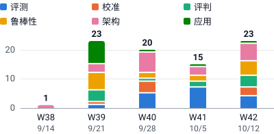

# Awesome Jev

[](https://awesomejev.github.io/zh/) [](https://github.com/reacher-z/Awesome-Jev/actions/workflows/ci.yml) [](LICENSE)

围绕 **Jev 与类型化决策模型**，整理研究论文、模型、数据集、评测工具与实践指南。

**[主仓库](https://github.com/reacher-z/Awesome-Jev)** · [网站](https://awesomejev.github.io/zh/) · [论文目录](https://awesomejev.github.io/zh/papers/) · [研究指南](https://awesomejev.github.io/zh/guide/) · [新增资源](https://awesomejev.github.io/zh/discoveries/) · [模型目录](https://awesomejev.github.io/zh/models/) · [工具目录](https://awesomejev.github.io/zh/tools/) · [研究专题](https://awesomejev.github.io/zh/topics/) · [English](README.md) · [综述](docs/survey.zh-CN.md) · [BibTeX](references.bib) · [参与贡献](CONTRIBUTING.md)

独立社区项目，与 TypeSafe AI 无隶属关系。最近整理：**2026-10-18**。网站从 [AwesomeJev.github.io](https://github.com/AwesomeJev/AwesomeJev.github.io) 仓库发布。

[新增资源目录](https://awesomejev.github.io/zh/discoveries/)补充了数百项项目、数据集、模型卡、指南和研究论文，并标明核查等级与相关性。[扩展审阅与计数方法](docs/expansion-2026-10-16.md)可供复查；摘要检查不等于全文评审。

## 从这里开始

| 你的任务 | 入口 | 能找到什么 |
| :--- | :--- | :--- |
| 理解研究进展 | [论文](https://awesomejev.github.io/zh/papers/) · [综述](docs/survey.zh-CN.md) | 固定版本的研究、贡献与证据局限。 |
| 比较模型 | [模型目录](https://awesomejev.github.io/zh/models/) | 发布者、声明许可与文档中的适用范围。 |
| 开发集成 | [工具目录](https://awesomejev.github.io/zh/tools/) · [快速开始](#快速开始) | 实现入口与最小API示例。 |
| 深入一个问题 | [研究专题](https://awesomejev.github.io/zh/topics/) · [指南](https://awesomejev.github.io/zh/guide/) | 带原始引用的解释，包括[校准与拒答](https://awesomejev.github.io/zh/topics/calibration-and-abstention/)。 |
| 探索更多来源 | [新增资源](https://awesomejev.github.io/zh/discoveries/) | 标明核查等级的项目、数据集与背景研究。 |

## 最近更新

按所链接版本的日期排列、最新的十项研究。完整列表见[论文](#论文)；更广泛的已筛查来源见[新增资源](https://awesomejev.github.io/zh/discoveries/)。

- 2026-10-15 · v1 · [Prism-1: Position- and Rival-Independent Scoring for System One Models](https://arxiv.org/abs/2610.22066v1) — 见[鲁棒性与安全](#鲁棒性与安全)
- 2026-10-15 · v1 · [Qwen-Audio-Jev: A Unified Interface for Audio Decisions](https://arxiv.org/abs/2610.21614v1) — 见[架构、记忆与多模态](#架构记忆与多模态)
- 2026-10-15 · v1 · [JevAgentHarness: Benchmarking, Deploying and Training Decision Models That Share Control with LLMs](https://arxiv.org/abs/2610.21412v1) — 见[评判与选择性自动化](#评判与选择性自动化)
- 2026-10-15 · v1 · [Jev-LiteMAS: Separating Decisions from Generation in Multi-Agent Workflows](https://arxiv.org/abs/2610.21411v1) — 见[评判与选择性自动化](#评判与选择性自动化)
- 2026-10-15 · v1 · [System1-Arena: Which Decisions Can Be Left to System 1?](https://arxiv.org/abs/2610.21244v1) — 见[评测与基准](#评测与基准)
- 2026-10-15 · v3 · [Jev for Scientific Decisions: Evaluating Semantic Choices and Their Consequences](https://arxiv.org/abs/2609.24965v3) — 见[应用与领域研究](#应用与领域研究)
- 2026-10-14 · v1 · [Prune the Summary, Not the History: Source-Judged Compaction for Long-Horizon Agents](https://arxiv.org/abs/2610.20927v1) — 见[架构、记忆与多模态](#架构记忆与多模态)
- 2026-10-14 · v1 · [From Detection to Decision: Calibration and Deferral for Prompt-Injection Detection](https://arxiv.org/abs/2610.20907v1) — 见[鲁棒性与安全](#鲁棒性与安全)
- 2026-10-14 · v1 · [Verdict: Encode Once, Decide Many](https://arxiv.org/abs/2610.20778v1) — 见[架构、记忆与多模态](#架构记忆与多模态)
- 2026-10-14 · v1 · [Lost in the Fallback: How Reliably Do Typed Decision Models Use Fallback Options?](https://arxiv.org/abs/2610.19856v1) — 见[鲁棒性与安全](#鲁棒性与安全)

## 目录

- [最近更新](#最近更新)
- [概览与官方资源](#概览与官方资源)
- [论文](#论文)
  - [评测与基准](#评测与基准)
  - [概率校准与一致性](#概率校准与一致性)
  - [评判与选择性自动化](#评判与选择性自动化)
  - [鲁棒性与安全](#鲁棒性与安全)
  - [架构、记忆与多模态](#架构记忆与多模态)
  - [应用与领域研究](#应用与领域研究)
- [模型](#模型)
- [基准与评测工具](#基准与评测工具)
- [数据集](#数据集)
- [SDK 与集成](#sdk-与集成)
- [实践指南](#实践指南)
- [基础与相关研究](#基础与相关研究)
- [快速开始](#快速开始)
- [来源核查](#来源核查)
- [参与贡献](#参与贡献)
- [许可](#许可)

## 概览与官方资源

TypeSafe 的 Jev 接收状态与类型化问题，为应用代码返回决策和概率。输出格式合法、语义正确和概率校准是不同的性质。

- [Introducing System One Models & Jev](https://typesafe.ai/blog/introducing-system-one-models-and-jev) — 发布文章与厂商主张。
- [官方文档](https://docs.typesafe.ai/introduction) · [API](https://docs.typesafe.ai/api) · [模型与版本](https://docs.typesafe.ai/models)。
- [Choice](https://docs.typesafe.ai/primitives/choice) — 在最多 255 个选项中选择，返回概率分布与置信度。
- [Score](https://docs.typesafe.ai/primitives/score) — 在文字描述的有序等级上返回概率加权位置。
- [Noul](https://docs.typesafe.ai/primitives/noul) — 返回“是”的概率，没有独立的 confidence 字段。
- [置信度说明](https://docs.typesafe.ai/confidence) · [Jev 1.13 已知局限](https://docs.typesafe.ai/model-jaggedness/jev-1.13)。
- [实验性图片输入](https://docs.typesafe.ai/images) · [Box](https://docs.typesafe.ai/primitives/box) — 需显式开启；Box 要求 Jev 1.14。
- [Jev 1.14 官方发布说明](https://typesafe.ai/blog/jev-1-14) — 2026-10-14 官方博文：`jev-1.14.0` 经 `jev-preview` 提供，图像与长上下文须通过请求头开关启用，Box 仅限 1.14。文中的能力对比由厂商自行测得，且自称可能偏向自家模型。

截至 **2026-10-17**，`jev-latest` 指向 `jev-1.13.0`，`jev-preview` 指向 `jev-1.14.0`；发布说明称 `jev-latest` 将在 2026-10-14 之后约一周改指 `jev-1.14.0`。评测时应固定版本。概念区别与评估协议见[综述](docs/survey.zh-CN.md)。

## 论文

下列 118 项直接研究均为 **arXiv 预印本**。日期对应已核查并链接的版本，不一定是首次提交日期。结果由作者报告，本项目没有复现实验。标题中的速度或成本主张保留作者原文。“材料”列中的“—”表示未列出相关材料。[参考文献](references.bib) · [证据比较](docs/survey.zh-CN.md)

<!-- papers-by-week: generated by scripts/build_site.mjs from site/catalog.mjs -->
<p><picture>
  <source media="(prefers-color-scheme: dark)" srcset="assets/papers-by-week-dark.zh-CN.svg">
  
</picture><br><sub>每周首次提交到 arXiv 的论文数（按主题）。按 ISO 周统计，日期为每周周一；只计本目录收录的论文，不代表该领域全部文献。</sub></p>

<details><summary>查看数据表</summary>

<table><thead><tr><th scope="col">主题</th><th scope="col">W38</th><th scope="col">W39</th><th scope="col">W40</th><th scope="col">W41</th><th scope="col">W42</th><th scope="col">合计</th></tr></thead><tbody><tr><th scope="row">评测</th><td>0</td><td>1</td><td>7</td><td>8</td><td>4</td><td>20</td></tr><tr><th scope="row">校准</th><td>0</td><td>4</td><td>6</td><td>0</td><td>4</td><td>14</td></tr><tr><th scope="row">评判</th><td>0</td><td>4</td><td>2</td><td>2</td><td>7</td><td>15</td></tr><tr><th scope="row">鲁棒性</th><td>0</td><td>6</td><td>3</td><td>4</td><td>7</td><td>20</td></tr><tr><th scope="row">架构</th><td>1</td><td>4</td><td>10</td><td>3</td><td>7</td><td>25</td></tr><tr><th scope="row">应用</th><td>0</td><td>10</td><td>8</td><td>5</td><td>1</td><td>24</td></tr><tr><th scope="row">合计</th><td>1</td><td>29</td><td>36</td><td>22</td><td>30</td><td>118</td></tr></tbody></table>

</details>
<!-- /papers-by-week -->

### 评测与基准

| 日&#8288;期&nbsp;·&nbsp;arXiv&nbsp;版&#8288;本 | 论文 | 主要发现 | 材料 |
| :--- | :--- | :--- | :--- |
| 2026-10-15<br>v1 | [System1-Arena: Which Decisions Can Be Left to System 1?](https://arxiv.org/abs/2610.21244v1)<br>Chen et al. | 以匹配请求与闭环任务比较决策模型和推理模型。 | [代码](https://github.com/TianyuCodings/S1-Arena) · [公开请求子集](https://huggingface.co/datasets/C-Tianyu/S1-Arena) |
| 2026-10-14<br>v1 | [Typed Decision Models on Tabular Data](https://arxiv.org/abs/2610.19536v1)<br>Zhang, Ye & Zha | 在三类表格任务中检验保持内容不变的改写对分类与验证的影响；置信度可提示不稳定，但不证明正确性。 | 专用研究代码尚未核验。 |
| 2026-10-13<br>v1 | [Jev-ToM: Evaluating Theory of Mind in Typed Decision Models](https://arxiv.org/abs/2610.18610v1)<br>Chung et al. | 在来自九个基准的 11,117 道英文心智理论题上，Jev 的来源均衡准确率为 73.2%，在十二个类型化与生成式模型中六类能力均列前二；基于置信度的选择效果因基准而异，附加理由则视其附加方式，可能纠错，也可能推翻正确答案。 | [题目、答案键与已保存的预测](https://github.com/HKUST-KnowComp/Jev-ToM)；各来源基准的使用条款仍然适用。 |
| 2026-10-13<br>v1 | [Reading Right, Acting Wrong: Diagnosing Decision Failures of System One Models in Agent Loops](https://arxiv.org/abs/2610.18579v1)<br>Li, Krishnan & Padman | 将事实探针与行动选择配对，诊断决策失败。 | [作者交互报告](https://yubol-bobo.github.io/System_one_model_evaluation/) |
| 2026-10-12<br>v2<br>首次提交<br>2026-10-02 | [General Decision Models: Benchmarking and Insights Beyond Jev](https://arxiv.org/abs/2610.03935v2)<br>Duan et al. | 双语决策评估与多步骤系统中的可靠性。 | [训练与推理代码](https://github.com/amazingljy1206/SII-Decision) · [评测数据](https://huggingface.co/datasets/carlosxiang/JEVal) |
| 2026-10-12<br>v3<br>首次提交<br>2026-10-05 | [GraphDecisionBench: Benchmarking System One Models on Graph Tasks](https://arxiv.org/abs/2610.06354v3)<br>Yang, Zhang & Zhao | 比较十四种模型—接口配置的图决策；局部邻接识别、图文证据利用与序列构造解的质量是不同能力。 | [代码与汇总结果](https://github.com/VictorYXL/GraphDecisionBench) |
| 2026-10-09<br>v1 | [Does System One Transfer? Calibrated Typed-Decision Models, Label Budgets, and Translation for Indonesian Regional Languages](https://arxiv.org/abs/2610.14112v1)<br>Fadli, Rusdah, Utami & Amana | 在印尼地方语言任务中测试 Jev 与多语言 Laya；预期校准误差稳定仍可伴随错误排序变差，人类翻译、标签预算与级联选择会改变比较条件。 | [作者链接的研究材料](https://github.com/tnromy/evaluating-system-one-models-for-indonesian-regional-languages) |
| 2026-10-09<br>v1 | [When Faster Decisions Do Not Make Better Agents: An Empirical Study of Jev in Agent Workflows](https://arxiv.org/abs/2610.13092v1)<br>Ling, Yu, Chen & Fang | Jev 让 ALFWorld 与 AndroidWorld 中五个 agent 的决策成本和时延下降（共 4,500 次运行），但两个移动端 agent 成功率降幅较大，辅助推理与额外交互抵消了节省，其中一个 agent 的单次成功成本反而上升。 | — |
| 2026-10-09<br>v2<br>首次提交<br>2026-10-08 | [TypedBench: A Benchmark for Calibration, Framing Sensitivity, and Cost in System One Decision Models](https://arxiv.org/abs/2610.11392v2)<br>Sharma, Duncan, Caron & Vollmer | 托管模型对措辞敏感且系统性信心不足，在非对称成本下按其概率行动的代价可能高于直接采用最高答案；基于带策略标签的合成测试集，还报告不同改写下的准确率范围及相对有限样本噪声下限的校准误差。 | — |
| 2026-10-08<br>v1 | [Specialized Decision Models vs. General-Purpose LLMs: Benchmarking Jev Across Knowledge, Reasoning, and Multilingual Tasks](https://arxiv.org/abs/2610.11978v1)<br>Li et al. | 在知识、推理和多语言选择题中评测 Jev；报告的排名及数学弱点仅适用于所选模型与基准。 | — |
| 2026-10-06<br>v1 | [Benchmarking System One Models in Online Moderation](https://arxiv.org/abs/2610.07953v1)<br>Mazzoni & Failla | 在五个审核基准中区分书面规则、检索先例和候选限制。检索可改善区分能力，也可能只是改变被标记内容的比例；使用带标签评测样本作先例、用生成描述表示媒体，会限制部署结论。 | 代码未核实 |
| 2026-10-06<br>v2<br>首次提交<br>2026-09-29 | [Benchmarking System One decision models against trained classifiers and language models for automated decision gates](https://arxiv.org/abs/2610.00346v2)<br>Rafe & Das | 用共同请求框架比较类型化决策模型、生成模型读出与已训练分类器；准确率、选择性覆盖率和域外接纳取决于是否有任务标签及具体任务。 | — |
| 2026-10-06<br>v2<br>首次提交<br>2026-10-05 | [JEV versus LLMs: Accuracy, Cost and Calibration on Seven Political Science Replications](https://arxiv.org/abs/2610.06625v2)<br>Denney & DiGiuseppe | 七项领域复现，比较准确率、成本与校准。 | — |
| 2026-10-05<br>v1 | [SoK: Semantic Decision Engines in Network Control Loops](https://arxiv.org/abs/2610.06425v1)<br>Li et al. | 综述网络控制环中的语义引擎，区分决策格式有效、动作可行、服务核查与期限达成；验证来自有界事件模型测试，而非生产部署。 | — |
| 2026-10-03<br>v2<br>首次提交<br>2026-09-28 | [Calibrated to Whom? Persona and Language Effects on Cultural Values in JEV](https://arxiv.org/abs/2609.36399v2)<br>Asseri & Asseri | 对 Jev 进行英语和阿拉伯语人物设定条件下的问卷审查；观察的是单一模型的模拟受访者，并非对真实人群的测量。 | — |
| 2026-10-02<br>v1 | [To Jev or Not? Evaluating the Accuracy and Efficiency of Structured Decision Models for Hate-Speech Moderation](https://arxiv.org/abs/2610.03324v1)<br>Paschalides, Pallis & Dikaiakos | HATEDECIDE 在四个英语数据集上测试定义与分解判断。更明确的标准会改变预测，却不稳定提高标注一致率；组件输出不是已核验的解释，诊断集成本比较也不能证明生产审核质量。 | 代码未核实 |
| 2026-10-01<br>v1 | [HakemBench: A Turkish Benchmark of Typed Decisions](https://arxiv.org/abs/2610.02293v1)<br>Teke | 土耳其语类型化决策评测同时报告决策质量、基于 Brier 的概率质量、风险—覆盖及输入探查；多数标签由 AI 产生，实验室自身模型还使用过先前测试结果的反馈。 | [基准代码与数据](https://github.com/ufakai/hakembench) · [模型实现](https://github.com/ufakai/ufakzeka-karar) · [检查点](https://huggingface.co/ufakai/ufakzeka-karar) |
| 2026-10-01<br>v1 | [Fast Models, Slow Evidence: A Paired and Self-Audited Evaluation of System-1 Decision Models for LLM Agent Harnesses](https://arxiv.org/abs/2610.02267v1)<br>Li | 成对评测 Laya／Jev 的 11 类 agent 决策并自查流程：前置筛查成本、端到端质量、阈值泄漏及不自然的通道内容都会改变部署结论。公开、英语为主的标签和零样本配置限制泛化。 | [代码](https://github.com/David-DL-Space/sys1-eval) · 已查说明和目录，未回放原始响应或分析。 |
| 2026-09-29<br>v1 | [Evaluating and Benchmarking the System One Model Jev](https://arxiv.org/abs/2609.37647v1)<br>Deußer, Sparrenberg & Sifa | 覆盖 37 个数据集的分类与决策评测。 | [代码](https://github.com/AppliedMachineLearning-Lab/jev-benchmarking) |
| 2026-09-26<br>v1 | [Typed Decision Models: An Early Evidence Audit and Evaluation Checklist](https://arxiv.org/abs/2609.32160v1)<br>Tang & Zheng | 类型化决策的早期证据梳理与评估清单。 | — |

### 概率校准与一致性

| 日&#8288;期&nbsp;·&nbsp;arXiv&nbsp;版&#8288;本 | 论文 | 主要发现 | 材料 |
| :--- | :--- | :--- | :--- |
| 2026-10-14<br>v1 | [Calibration and Risk-Budgeted Decisions with System One Models](https://arxiv.org/abs/2610.19811v1)<br>Messoudi & Mansar | Jev 等 System One 模型在无法转交人工时做二元放行／拦截或保留／丢弃决策；在六个审核、安全与重排序数据集上，朴素阈值选择约在一半设置中超出目标风险，Learn Then Test 仅为 7.8%。 | — |
| 2026-10-14<br>v1 | [Are AI Decision Models Biased? A Case Study of Jev](https://arxiv.org/abs/2610.19619v1)<br>Imperatrice, Kameneva, Greenberg & Romano | 在 41,500 次回答中，Jev 选出的答案大体未显示偏差，但其判断会受无关数字和选项顺序影响，部分认知偏差操纵即使不改变所选答案也会明显改变返回的概率；在 30 个改编的合取任务上，15,000 次回答中有 54% 违反合取规则。 | — |
| 2026-10-14<br>v2<br>首次提交<br>2026-09-30 | [More Choices, Fewer Decisions: Ordinal-Scale Bias in JEV-like Direct-Decision Models](https://arxiv.org/abs/2609.38827v2)<br>Gao et al. | 审查所选决策模型对有序标签的使用不足；细化量表会加重压缩，准确率、最终标签利用率和平均候选概率仍是不同测量。 | [匿名代码材料](https://anonymous.4open.science/r/jev_ordinal_scale_bia/)；匿名镜像，2027-04-10 到期。 |
| 2026-10-13<br>v1 | [Recalibrating Many Questions with Few Labels: Minimax Rates and Identification Limits](https://arxiv.org/abs/2610.18488v1)<br>Li & Yang | 在共享输出分布与单调性假设下，推导跨问题合并重校准的超额 Brier 风险界；固定效应与经验贝叶斯结果的目标不同，风险下界不能直接视为校准误差下界。 | — |
| 2026-10-12<br>v1 | [Does a Hosted Decision Model Respect Irrelevant Alternatives? A Pre-Registered Test of Option-Set Dependence in Jev](https://arxiv.org/abs/2610.16655v1)<br>Rajput, Chauhan & Kosaraju | 加入无关选项会改变 jev-1.13.0 对正确标签与最强错误标签的对数几率，选项越多偏移越大，因此其概率只相对于所给选项列表成立；逐项独立的是非评分可消除这种依赖，但准确率更低（预注册，299,463 次调用，三个数据集）。 | — |
| 2026-10-06<br>v2<br>首次提交<br>2026-10-02 | [Benchmarking candidate coverage and rejection policy transfer in typed decision models](https://arxiv.org/abs/2610.03387v2)<br>Lu & Wu | 在相同校准预算下区分人为移除、检索遗漏与范围外查询；源任务阈值可能误拒目标任务中已有答案的输入，或漏检缺失答案。候选成员、标签歧义及自然遗漏的小样本限制迁移结论。 | [代码](https://github.com/luckykevvv/Decision_Model_Benchmark) · 已记录输出评分与源文本重建、重新推理分开。 |
| 2026-10-05<br>v2<br>首次提交<br>2026-09-27 | [Probability Contracts: Accuracy, Coherence, and Decisions Across LLM Interfaces](https://arxiv.org/abs/2609.37470v2)<br>Chen & Li | 用已知后验的有限世界区分概率准确性、接口一致性和决策损失。取平均可改善期望 Brier 分数，却不保证每个转交成本下的策略更好；有效输出覆盖率与具体对照策略不可省略。 | 代码未核实 |
| 2026-10-01<br>v1 | [Beyond Answer Confidence: A Controlled Audit of Self-Knowledge in a Black-Box Decision Model](https://arxiv.org/abs/2610.01006v1)<br>Shankaranarayana, Runje & Jannink | 通过控制信息与表面线索，区分 Jev 的答案置信度与是否知道答案的自评；黑盒表现并不证明能读取内部知识状态。 | [代码](https://github.com/Syntheme/beyond-answer-confidence) |
| 2026-09-30<br>v1 | [AnyJev Technical Report](https://arxiv.org/abs/2610.00831v1)<br>Zhang et al. | 无需训练的概率读出，修正标签先验与选项顺序偏差。 | [代码](https://github.com/nokia-applied-research/AnyJev) |
| 2026-09-30<br>v1 | [OpenJev-RLCD: A Working RLCD Implementation](https://arxiv.org/abs/2609.38850v1)<br>Gao & Wang | 独立的两阶段 RLCD 方法先校准推理模型的答案读出，再用适当评分奖励强化推理。1.7B 模型上的三种子结果显示收益随任务变化；实现明确不声称还原 TypeSafe 内部训练算法。 | [代码](https://github.com/ZimmyGao/openjev-rlcd) · 独立实现，未回放公开结果文件。 |
| 2026-09-28<br>v1 | [Jev thinks “I don’t know”, but doesn’t say it: Introducing Sys1Cal-v1 Dataset for Probability Calibration](https://arxiv.org/abs/2609.35342v1)<br>Porcedda | 以构造概率目标进行受控校准测试。 | [代码与合成基准](https://github.com/little-g-ai/Sys1Cal-v1) |
| 2026-09-27<br>v1 | [Laya as a Typed Probabilistic Assessor: An Independent Reproduction and a Preregistered Study of Calibration and Selective Escalation](https://arxiv.org/abs/2609.33843v1)<br>Nandakishore | 固定版本 Laya 检查点在合成教师标签上信心不足。温度拟合改善概率指标，但冻结的校准器选择规则与升级门控未达到留出目标；Jev 对照来自间接引用，初始复现早于预注册。 | [代码](https://arxiv.org/src/2609.33843v1/anc/metrics.py) · [数据](https://arxiv.org/src/2609.33843v1/anc) · 指标代码与附属记录；不包含完整训练／采集源码。 |
| 2026-09-27<br>v1 | [Beyond Calibration: Do a Typed-Decision Model’s Probabilities Obey the Probability Axioms?](https://arxiv.org/abs/2609.33209v1)<br>Li, He & Li | 检验逻辑相关问题之间的概率一致性。 | [代码与调用记录](https://github.com/bro789/typed-decision-coherence) |

| 2026-09-26<br>v1 | [PACT: Pairwise-Anchored Calibrated Tuning for Single-Token Typed Decisions](https://arxiv.org/abs/2609.35865v1)<br>Lin | 利用带证书的对比样本对、排列一致性和上下文温度拟合改善决策稳定性与序数误差；留出集仅324条合成样本，模型尺度单一，且依赖证书正确性，推广范围有限。 | [代码](https://github.com/BennyLinntu/PACT-Pairwise-Anchored-Calibrated-Tuning-for-Single-Token-Typed-Decisions) · 论文结果与仓库中后续的单次 Tetris 演示应分开解读。 |
### 评判与选择性自动化

| 日&#8288;期&nbsp;·&nbsp;arXiv&nbsp;版&#8288;本 | 论文 | 主要发现 | 材料 |
| :--- | :--- | :--- | :--- |
| 2026-10-15<br>v1 | [JevAgentHarness: Benchmarking, Deploying and Training Decision Models That Share Control with LLMs](https://arxiv.org/abs/2610.21412v1)<br>Zhu et al. | 为各类选择拟合阈值，让决策模型与 LLM 共享 agent 控制。 | [代码](https://github.com/JevAgentHarness/JevAgentHarness) |
| 2026-10-15<br>v1 | [Jev-LiteMAS: Separating Decisions from Generation in Multi-Agent Workflows](https://arxiv.org/abs/2610.21411v1)<br>Wang, Zhou, Lou & Li | 在生成式复审前进行专家交接路由和产物筛查；生成模型的 token 节省取决于任务，专家池固定，需要修复的产物越多，节省可能越少。 | 代码未核实 |
| 2026-10-14<br>v1 | [Selective Reasoning for Typed Decision Models: When to Start, Read, and Stop](https://arxiv.org/abs/2610.19644v1)<br>Zheng & Chen | 控制推理启动、候选答案读取与生成停止的时机；证据限于冻结的 Qwen 骨干及三类任务。 | [代码与已保存的测量材料](https://github.com/binzheng-joey/selective-reasoning)；仅检查 README，未执行。 |
| 2026-10-13<br>v1 | [BLADE: Auditing Information Use for Failure Attribution in LLM Multi-Agent Systems](https://arxiv.org/abs/2610.18780v1)<br>Guo, Long & Zhang | 用 Jev 审查 agent 交接时如何使用信息并定位失效；比较在五个基准子集上共用一个决策模型，归因质量受所保留轨迹证据完整性限制。 | 代码未核实 |
| 2026-10-13<br>v1 | [PRISM: Calibrating Black-Box Judges with Counterfactual Probes](https://arxiv.org/abs/2610.18389v1)<br>Yamamoto & Kuroki | 利用反事实评分探针和人类标签学习校正；两个文本任务上的排序一致性提升不同于概率校准，额外探针成本与跨任务迁移仍是重要限制。 | 代码未核实 |
| 2026-10-13<br>v1 | [Cheap, Consistent, Calibrated, but Biased? Typed Decision Models as Judges](https://arxiv.org/abs/2610.18122v1)<br>Lukassen, Weisser & Silbersdorff | CALM 成对挑战显示，一致性和校准并不能消除位置与改写敏感性；沿用的参考标签，以及不只改变语气的改写，限制了因果解释和对其他评判任务的推广。 | [代码](https://github.com/fabian-lu/TDM_as_a_Judge) · 声明代码为 MIT；基准与结果为 CC BY-NC-SA 4.0。 |
| 2026-10-13<br>v3<br>首次提交<br>2026-09-24 | [Decision Models vs. LLMs as Rubric Judges: Cheaper, Faster, and Wrong in the Same Places](https://arxiv.org/abs/2609.29769v3)<br>Rao & Callison-Burch | 评分准则评判、相关错误与级联收益的局限。 | — |
| 2026-10-13<br>v1 | [Judges Follow the Reference: The Derivation Gap in Verifying Tool-Call Arguments](https://arxiv.org/abs/2610.18497v1)<br>Ma et al. | 包括 Jev 在内的工具参数评判模型，在缺少可见参考时会拒绝部分正确推导值；模型生成的参考在三个基准上接受评测。 | [代码](https://github.com/SarielMa/DeRef_release) · [评测数据](https://huggingface.co/datasets/lm2445/DeRef)；不包含模型输出。 |
| 2026-10-11<br>v1 | [Suggested Is Not Superseded: A Pre-Registered Evaluation of a System-One Model as a Memory-Retirement Gate](https://arxiv.org/abs/2610.15710v1)<br>Chen & Le | Jev 旧记忆停用评测区分已确认更新与变化暗示；LLM／人工混合标注、共享错误及小型开发集上的选择限制了级联收益主张。 | — |
| 2026-10-10<br>v2<br>首次提交<br>2026-10-06 | [JevCascade: Readout Stability and Inference-Time Compute Allocation for Prefill-Only Decision Models](https://arxiv.org/abs/2610.07716v2)<br>Li & Chen | 研究候选集合干预与置信度级联；排序稳定性并不等同概率校准。 | [代码与数据](https://github.com/rlisml/jev-cascade) |
| 2026-10-09<br>v5<br>首次提交<br>2026-09-22 | [JEV-as-a-Judge: Accept When Confident, Escalate When Unsure](https://arxiv.org/abs/2609.26550v5)<br>Li, Miao, Krishnan & Padman | 基于置信度从 Jev 升级到推理评判模型。 | [项目页](https://yubol-bobo.github.io/jev-as-a-judge/) |
| 2026-09-30<br>v1 | [Jev-as-a-Judge for RAG Claim Verification: Confidence-Gated Cascading Between a Non-Generative Verifier and a Frontier LLM](https://arxiv.org/abs/2610.20634v1)<br>Do Rosario & Atef | 对 495 条 RAG 声明的成对核验显示，汇总分数相近仍可有不同的误放率。一个阈值经过交叉拟合，但设计选择与同预算随机升级对照仍属探索；模拟节省不证明等效性或生产门控更优。 | [代码](https://github.com/adorosario/jev-rag-claim-verification) · 参考标签需取得上游数据访问权限；离线回放并非已部署级联。 |
| 2026-09-28<br>v1 | [JEV as a Judge for Agent Trace Security: An Empirical Comparison with Generative LLM Judges](https://arxiv.org/abs/2609.34862v1)<br>Wang & Gao | 比较 Jev 与生成式评判模型对历史 agent 轨迹的风险分类；排名因数据集而异，成功调用耗时和有效判断成本需结合覆盖率解读。 | — |
| 2026-09-25<br>v1 | [LAVOIR: Teaching a Single-Pass Decision Encoder When and What to Ask with Amortized Value of Information](https://arxiv.org/abs/2609.30706v1)<br>Yilmaz, Tasdemir & Gozay | 在给出决策概率的同时估计追问缺失信息的价值。 | [代码](https://github.com/moganai/lavoir) · [检查点](https://huggingface.co/moganai/lavoir) |
| 2026-09-22<br>v1 | [REFLEX with Jev for Efficient Selective Control in LLM Agents](https://arxiv.org/abs/2609.26532v1)<br>Wu & Lim | 以置信度控制 Jev 与 LLM 回退；收益取决于候选动作与基线路由。 | — |

### 鲁棒性与安全

| 日&#8288;期&nbsp;·&nbsp;arXiv&nbsp;版&#8288;本 | 论文 | 主要发现 | 材料 |
| :--- | :--- | :--- | :--- |
| 2026-10-15<br>v1 | [Prism-1: Position- and Rival-Independent Scoring for System One Models](https://arxiv.org/abs/2610.22066v1)<br>Teng et al. | 通过隔离选项读出，使排列和候选变化时原有选项间的概率比保持稳定；需要微调并限制模型内选项比较，更适合可独立判断的选项，而非依赖整个候选集的兜底规则。 | 代码未核实 |
| 2026-10-14<br>v1 | [From Detection to Decision: Calibration and Deferral for Prompt-Injection Detection](https://arxiv.org/abs/2610.20907v1)<br>Lan, Kaul, Pandurangan & Sanyal | 在 47,611 条留出的提示注入样本上，Jev 的 AUROC 仅次于 LLM 评审，其原生概率并不总优于事后校准的分类器分数；若把漏报率目标定为 1%，所有门控—复核系统都需升级处理超过 91.8% 的输入。 | — |
| 2026-10-14<br>v1 | [Lost in the Fallback: How Reliably Do Typed Decision Models Use Fallback Options?](https://arxiv.org/abs/2610.19856v1)<br>Xie et al. | 三个文本数据集的成对测试将类别识别与兜底规则执行分开；即使给出正确类别，所测开放模型在等价定义下仍可能产生分歧。研究诊断失效，未确立修复方法。 | 代码未核实 |
| 2026-10-13<br>v1 | [DecisionRobust: Benchmarking Robustness for JEV Style Decision Models Across Text and Vision](https://arxiv.org/abs/2610.19118v1)<br>Lan et al. | 结合标签有效性检查与留出模型，评估文本和视觉攻击。 | [代码](https://github.com/Yifan-Lan/DecisionRobust) · [基准站点](https://yifan-lan.github.io/DecisionRobust/) |
| 2026-10-13<br>v1 | [Nudge the Judge: Uncovering Program Decision Hijacking in Real-World Jev Applications](https://arxiv.org/abs/2610.18612v1)<br>Luo et al. | JevProbe 追踪攻击者可控的上下文如何影响 228 个热门 Jev 应用据以执行的决策；在 2,273 个精选用例中（每个应用至多十条、优先选取翻转案例，并非无偏样本），81.5% 出现决策翻转，其中 98.6% 可能造成下游安全影响，现有防御作用有限。 | [代码与 JevProbeBench](https://github.com/xiaoxiaohg8d/JevProbe-)；仅检查 README，未执行。 |
| 2026-10-13<br>v1 | [Consider, Then Choose: Order-Invariant Decisions in System One Models](https://arxiv.org/abs/2610.18233v1)<br>Huang, Teng, Deng & An | Runoff 先逐个评分选项，再平衡入围候选的位置；顺序不变性假设响应确定且排序唯一，不能解决选项名称偏置，也不保证决策更准确。 | 代码未核实 |
| 2026-10-13<br>v1 | [Same Attack, Different Judge: A First Controlled Adversarial Comparison of Jev, LLM Judges, and Purpose-Built Safety Classifiers](https://arxiv.org/abs/2610.17820v1)<br>Li, Huang, Zhang & Liu | 对决策模型与安全分类器进行受控对抗比较。 | — |
| 2026-10-11<br>v1 | [Poisoned into Action: Context Attacks on Typed Decision Workflows](https://arxiv.org/abs/2610.15537v1)<br>Wu, Chang & Yan | 追踪上下文投毒经检索、类型化选择到持久化执行的路径，并衡量保留的正常任务效用；仅覆盖两个合成开发工作流，预设比较未达显著，结论仍属探索性。 | [代码](https://github.com/WuXixiong/jev-poisoning-bench) · 公开子集；完整调用归档与私有证明材料未包含。 |
| 2026-10-09<br>v1 | [DICE: Tilting the Odds through Interface Attackson System One Model](https://arxiv.org/abs/2610.14404v1)<br>Dong, Lu, Guo & Wang | 在状态抽取、问题生成和输出解释适配层测试有界替换，保持 Jev 原始响应不变；三个合成试验定位决策完整性失效，不估计实际部署中的攻击发生率。 | 代码未核实 |
| 2026-10-08<br>v3<br>首次提交<br>2026-09-22 | [Type-Safe Is Not Error-Free: Typed Decision Models Follow the Option Name, Not the Definition Bound to It](https://arxiv.org/abs/2609.26758v3)<br>Sun, Xu, Shi & Yang | 检验结构合法的输出是否仍会服从选项名称而非定义。 | — |
| 2026-10-08<br>v1 | [One Word Opens the Gate: The Option-Channel Attack on Typed Decision Models as Agent Guardrails](https://arxiv.org/abs/2610.12292v1)<br>Azizi, Baghaei Potraghloo & Pedram | 测试七个开放权重模型的选项通道攻击；决策翻转后仍可能高置信。报告中的实验未测试托管 Jev。 | [代码与缓存分析材料](https://github.com/ArminAzizi98/option-channel-attack) |
| 2026-10-08<br>v2<br>首次提交<br>2026-09-24 | [JevOut: Natural Context Can Flip Decision Models](https://arxiv.org/abs/2609.30243v2)<br>Xu et al. | 在四种决策系统中围绕不变的题目和选项优化上下文补充；结果针对原本答对的决策，人工有效性检查仅覆盖成功攻击的抽样子集。 | [代码](https://github.com/xzx34/JevOut) |
| 2026-10-06<br>v1 | [Same-Number Citation Swaps: Stress-Testing Jev as a Financial Evidence Judge](https://arxiv.org/abs/2610.08675v1)<br>Xu et al. | 以同数值引用替换检验金融证据验证；在构造测试中，识别财务项目错配与接受等价证据之间存在权衡。 不构成总体金融判断准确率估计。 | — |
| 2026-10-04<br>v1 | [Hidden Risks of Jev: An Empirical Study of Security, Privacy, and Dual Use](https://arxiv.org/abs/2610.04985v1)<br>Wang et al. | 以官方 Jev API 和本地模型 NanoJev 检验提示注入、数据投毒后门，成员、属性与内部知识推断，以及四项检测任务中的双重用途；作者报告 Jev 对所考察的威胁仍然脆弱。 | [部分代码：NanoJev 后门实验](https://github.com/shihe98/Security_Privacy_Jev)；未声明许可。 |
| 2026-10-03<br>v3<br>首次提交<br>2026-09-27 | [Evaluating System One Models for Agent Security Decisions: Reliability, Calibration, and Selective Automation](https://arxiv.org/abs/2609.33401v3)<br>Liu | 考察非对称风险下的高置信安全错误与选择性自动化。 | [代码与已保存结果分析](https://github.com/yxsec/system-one-security-eval) |
| 2026-10-01<br>v1 | [Labels Override Definitions in Jev-Style Typed Decision Models](https://arxiv.org/abs/2610.02586v1)<br>Azizi, Baghaei Potraghloo & Pedram | 研究开放权重决策模型的选项标签偏置；固定权重后改变提示渲染，指向标签／定义接口的影响，未测试托管 Jev。 | — |
| 2026-09-30<br>v1 | [When the Right Answer Is Missing: An Arithmetic-Dependent Rejection Bottleneck in Jev](https://arxiv.org/abs/2609.39496v1)<br>Zhong, Li & Lai | 成对数值候选集揭示：答案存在时选择较强，缺失时却难以选中“以上皆非”。独立开发集阈值改善了所测拒答表现，布尔核验则呈现不同结果；这是接口相关失效诊断，不揭示内部机制或普遍阈值迁移。 | 代码未核实 |
| 2026-09-25<br>v1 | [JevAdvBench: A Benchmark and Black-Box Attacks for Reinforcement Learning for Calibrated Decisions Models](https://arxiv.org/abs/2609.31142v1)<br>Hu et al. | 将对抗输入变化与干净输入、重复调用的自然波动对照。 | [代码](https://github.com/JevAdvBench/JevAdvBench) · [基准数据](https://huggingface.co/datasets/Hangtao/JevAdvBench) |
| 2026-09-24<br>v1 | [Just Ask Jev: Reinforcement Learning for Calibrated Decisions as a Zero-Shot Detector of AI Alignment Failures](https://arxiv.org/abs/2609.29429v1)<br>Guo et al. | 评测 Jev 对 AI 对齐失效的检测，分别改变提问与输入上下文；参考标签主要来自基准评分器，上下文收益常依赖编码标签的字段。 | [代码与数据](https://github.com/sumleo/RLCDAlignBench) |
| 2026-09-23<br>v1 | [Decision Hijacking: Prompt Injection Attacks on Jev's Typed Probabilistic Decisions](https://arxiv.org/abs/2609.28613v1)<br>Wu & Lim | 在重构的 InjecAgent 案例中审查 Jev 提示注入，区分概率偏移与攻击目标选择；优化结果通过新调用验证，结论限于该基准设置。 | — |

### 架构、记忆与多模态

| 日&#8288;期&nbsp;·&nbsp;arXiv&nbsp;版&#8288;本 | 论文 | 主要发现 | 材料 |
| :--- | :--- | :--- | :--- |
| 2026-10-15<br>v1 | [Qwen-Audio-Jev: A Unified Interface for Audio Decisions](https://arxiv.org/abs/2610.21614v1)<br>Fang et al. | 在 Qwen-Audio-3.1-ASR-Flash-Next 上加入独立实现的 Jev 式决策头，对音频给出 Choice、Noul 与 Score 读出；报告 MMSU 准确率 84.06%、说话人验证等错误率 6.50%，推理速度约为其基础模型的 20 倍。 | — |
| 2026-10-14<br>v1 | [Prune the Summary, Not the History: Source-Judged Compaction for Long-Horizon Agents](https://arxiv.org/abs/2610.20927v1)<br>Min & Chen | 用 Jev 删除缺少来源支持的摘要条目；所报收益衡量两个基准上三次独立运行均成功的比例，但有用约束可能被删去，有来源的错误也可能保留。 | [代码](https://github.com/GuanghuiMin/sjc) · 需另行配置基准环境和模型 API，本项目未运行。 |
| 2026-10-14<br>v1 | [Verdict: Encode Once, Decide Many](https://arxiv.org/abs/2610.20778v1)<br>Chouhan & Perry | 一次编码共享状态，回答多个类型化问题；不变性要求保留的状态 token 一致，教师模型标签、适应性测试过程及 BoolQ 训练不稳定限制了所报收益的解读。 | [代码](https://github.com/LEC-AI/verdict) · 提供代码与已保存结果，未发布训练后的检查点。 |
| 2026-10-13<br>v3<br>首次提交<br>2026-10-01 | [LLM-as-Jev: LLMs Are Already Jev-Style Decision Models -- When and How to Fine-Tune Them](https://arxiv.org/abs/2610.02076v3)<br>Li & Wagle | 比较冻结 Qwen 的决策读出、带 KL 锚定的可选微调与限预算推理；所报收益依赖骨干规模和路由任务，并不揭示托管 Jev 内部实现。 | — |
| 2026-10-13<br>v1 | [Jeva: System One Models from First Principles](https://arxiv.org/abs/2610.18773v1)<br>Li & Wang | 空答案、选项排列、可变候选集与缓存机制。 | [架构代码](https://github.com/LiQiiiii/Jeva) · [检查点](https://huggingface.co/LIQIIIII/Jeva-4B) |
| 2026-10-13<br>v1 | [VideoJev: System One Model for Video Understanding and Interaction](https://arxiv.org/abs/2610.18615v1)<br>Zhu et al. | 以时间区间和候选分数表达视频决策，通过缓存与联合推理复用视觉计算。 | [项目页](https://mcg-nju.github.io/VideoJev/) |
| 2026-10-12<br>v1 | [Releasing the Inner Jev: A Simple Recipe for Open Decision Models](https://arxiv.org/abs/2610.17205v1)<br>Geuter, Cheng & Alvarez-Melis | 答案字母概率读出与监督式 LoRA 基线；评测包含模型生成的标签。 | [服务代码](https://github.com/j-geuter/jeff-serve) · [OpenDecisions](https://huggingface.co/datasets/jgeuter/OpenDecisions) |
| 2026-10-12<br>v1 | [FunDM: Cheap & Label-Free Decision Models from Frozen Language Models](https://arxiv.org/abs/2610.17175v1)<br>Panchal | 把教师概率蒸馏到较浅的冻结 Qwen3-8B 计算路径上的小型决策头；无标签指不使用正确答案训练标签，效率测量只覆盖一个 GPU 和引擎任务，而非生产服务。 | [代码](https://github.com/Ujjawal-K-Panchal/FunDM) |
| 2026-10-10<br>v2<br>首次提交<br>2026-10-06 | [SanSi: A Looped Typed Decision Model for System 1.5 Thinking](https://arxiv.org/abs/2610.07730v2)<br>Gan, Lee & Kang | 通过隐状态循环计算决策，以额外计算成本换取准确率。 | [训练与主要评测代码](https://github.com/minnesotanlp/Sansi)覆盖论文的部分实验。 |
| 2026-10-10<br>v2<br>首次提交<br>2026-09-28 | [Koa-decision: Fast and Consistent Structured Decision Making with Generative LLMs](https://arxiv.org/abs/2609.36115v2)<br>Dai et al. | 通过原子标签 token 和监督微调实现单步受约束决策；延迟采用指定的顺序服务测量协议，不同基线的适配程度不同，生产意图数据无法公开。 | 代码未核实 |
| 2026-10-08<br>v1 | [MetaEncoder: Exploring the Limit of Bi-Encoders for Multimodal System One Decision Making with Natural Language Interface](https://arxiv.org/abs/2610.11316v1)<br>Cheng et al. | 通过自然语言接口实现多模态决策与检索的双编码器方法。 | [评测代码](https://github.com/facebook/meta-encoder-eval) |
| 2026-10-05<br>v1 | [ufakzeka-karar: An Open Turkish Typed-Decision Model with Order-Invariant Option Scoring](https://arxiv.org/abs/2610.06744v1)<br>Teke | 开源的 1.82 亿参数土耳其语模型对每个选项独立评分，答案不受选项顺序影响，并提供“不确定”信号；其在 HakemBench 16 行中排第 7 的结果并非盲测，因为后续训练是在读过完整测试结果后进行的。 | [代码](https://github.com/ufakai/ufakzeka-karar) · [检查点](https://huggingface.co/ufakai/ufakzeka-karar)；Apache-2.0。 |
| 2026-10-02<br>v1 | [Batched Speech Decisions Without Decoding: Single-Token Supervision Lets a Frozen LLM Hear Beyond the Transcript](https://arxiv.org/abs/2610.02638v1)<br>Jin et al. | DuplexJev 将 ASR 隐藏状态接入冻结 LLM，通过答案 token 读出批量决策；连接器相关的语音任务结果与八 GPU 计时，不能证明单设备或实时 agent 延迟。 | [作者链接的实现](https://github.com/adventists-ai/duplexjev) |
| 2026-10-01<br>v1 | [Student-Guided Teacher Distillation for Efficient LLM Task Routing: Positioning Against Jev-Style System-1 Classifiers](https://arxiv.org/abs/2610.02516v1)<br>Wu et al. | 面向固定 60 标签任务分类的初步蒸馏研究，用学生候选表减少教师评分。与教师一致不等于人工准确率，完整留出对照仍待完成；最佳检查点与服务测量版本不同，未建立与 Jev 的直接对照结果。 | 代码未核实 |
| 2026-10-01<br>v1 | [AudioJev: Direct Audio Decisions with Order-Calibrated Probabilities](https://arxiv.org/abs/2610.01293v1)<br>Lv et al. | 通过按候选身份对齐的选项重排训练学习音频条件概率；顺序稳定性与概率符合实际正确率仍是不同性质。 | [推理库](https://github.com/SihanLv/AudioJev-Inference) · [发布检查点](https://huggingface.co/shlv/AudioJev) |
| 2026-09-30<br>v1 | [JevSpawn: Adaptive Agentic Inference through Compositional Action Spaces](https://arxiv.org/abs/2610.00437v1)<br>Su & Huang | 组合有限行动字段，利用交互反馈探索候选路径。 | [代码](https://github.com/Hoyant-Su/JevSpawn) |
| 2026-09-30<br>v1 | [Bongard: Training Machine Intuition](https://arxiv.org/abs/2609.39111v1)<br>Ding, Jin & Ji | 共享证据编码与候选概率读出，结合表征学习和行动结果反馈训练。 | [模型权重](https://huggingface.co/AgentBull/bongard-mini) |
| 2026-09-29<br>v1 | [Chinese-Jev: Bringing System One Model to Chinese-Language Tasks](https://arxiv.org/abs/2609.36965v1)<br>Wang et al. | 中文决策模型训练与领域评测。 | [训练流水线](https://github.com/gulucaptain/Chinese-Jev) · [CJ-Bench 评测集](https://huggingface.co/datasets/bbldCVer-hf/CJ-Bench) · [CJ-Dataset 训练集](https://huggingface.co/datasets/bbldCVer-hf/CJ-Dataset) |
| 2026-09-28<br>v1 | [Dyad: Extending Large Language Models with Native Typed Decision-Making](https://arxiv.org/abs/2609.36116v1)<br>Zhan et al. | 为 LLM 加入环境条件化行动编码器以选择类型化动作；冻结 LLM 仅适配编码器与联合强化学习是不同设置，Jev 延迟比较引用既有 API 测量。 | 代码未核实 |
| 2026-09-28<br>v1 | [Mnemon: Raw Records, Fast Judgments, Slow Thoughts](https://arxiv.org/abs/2609.36059v1)<br>Wang | 保留原始记忆记录，将 Jev 相关性判断与 LLM 检索规划、回答生成分开。 | [代码与运行记录](https://github.com/Grivn/mnemon-memory-agent) |
| 2026-09-24<br>v1 | [From Text Decisions to Pixels: An Study of Jev-Style Visual Choice Model](https://arxiv.org/abs/2609.29283v1)<br>Zhou, Yang & Zhao | 视觉选择模型，分别考察适配与校准。 | — |
| 2026-09-23<br>v1 | [NumericJev: Jev-like LLM Numerical Decoding with Multiway Decision Trees](https://arxiv.org/abs/2609.28587v1)<br>Ye, Liu & Jiang | 无需重训，通过重复 Choice 调用缩小已知数值区间。分辨率不等于准确性或已校准不确定性，早期错误分支不可逆。算术变体共享 64 个基础问题族；历史指数回忆与后续控制演示属于不同证据。 | [代码](https://github.com/Bring-AI/JevNext) · 仓库已更名 JevNext，当前版本声明 PolyForm Noncommercial 1.0.0。 |
| 2026-09-22<br>v1 | [Visual Jev: Accurate and Efficient Decisions from Shared Visual Context](https://arxiv.org/abs/2609.25845v1)<br>Yu & Yao | 独立的视觉决策架构以语言模型头读出，让批处理问题共享图像上下文；预热后的摊销加速伴随更高峰值内存，准确率收益集中于训练覆盖的任务家族。 | [代码与复现范围](https://github.com/guanxuyu-sv/Visual-Jev) |
| 2026-09-21<br>v1 | [Jev-Mem: System-One-Controlled Agentic Memory for Efficient AI Agents](https://arxiv.org/abs/2609.23986v1)<br>Jiang, Li & Li | 以决策模型控制 agent 记忆构建与检索。 | [代码](https://github.com/libingzheren/Jev-Mem) |
| 2026-09-20<br>v1 | [this-that-model-1.0: A typed decision model that decides in 30 ms, for a millionth of a cent](https://arxiv.org/abs/2609.23886v1)<br>Cheng, Dai & Sun | 采用隐藏状态概率读出的类型化决策架构。 | [模型](https://huggingface.co/flock-io/this-that-model-1.0) · [推理代码](https://github.com/FLock-io/this-that-model) · [空间推理基准](https://huggingface.co/datasets/limberc/this-that-spatial-bench) |

### 应用与领域研究

| 日&#8288;期&nbsp;·&nbsp;arXiv&nbsp;版&#8288;本 | 论文 | 主要发现 | 材料 |
| :--- | :--- | :--- | :--- |
| 2026-10-15<br>v3<br>首次提交<br>2026-09-21 | [Jev for Scientific Decisions: Evaluating Semantic Choices and Their Consequences](https://arxiv.org/abs/2609.24965v3)<br>Deng, Fan, Zhang & Xie | 作者在十个预设科学案例中分别评估语义选择、计算得到的数值与最终标签；对比模型的错误可能被不变的最终标签掩盖。 | [代码与发布范围](https://github.com/bydeng01/scientific-decision-eval) |
| 2026-10-14<br>v2<br>首次提交<br>2026-10-02 | [SecJev: Bringing Security Expertise to System One Decision Models](https://arxiv.org/abs/2610.03073v2)<br>Chen et al. | 将决策评分器适配到14项安全任务；来源标签预测与显式策略执行是不同目标，任务难度不均，基准准确率不证明端到端攻击防护能力。 | [代码](https://github.com/UESTC1010/SecJev) · [数据](https://github.com/UESTC1010/SecJev/releases/tag/v1.0.0) · [模型发布](https://github.com/UESTC1010/SecJev/releases/tag/v1.3.0) · 已查发布元数据，未加载包；适用自定义协议及上游条款。 |
| 2026-10-13<br>v1 | [How Reliable Are System-One Decisions in Medicine? A Comparative Study of Jev, Jev-like Models, and LLMs](https://arxiv.org/abs/2610.18529v1)<br>Du et al. | 在 15 个医学数据集（8,742 个实例）上，Jev 在文本主导任务上可比肩领先模型、数值任务较弱，题目格式变化下最稳定；多数模型难以识别正确答案缺失。这是基准研究，不是临床验证。 | — |
| 2026-10-10<br>v2<br>首次提交<br>2026-09-23 | [Same Scores, Different Decisions: Evaluating JEV and Language Models for Legal Document Understanding](https://arxiv.org/abs/2609.27678v2)<br>Zhang et al. | ContractNLI 请求变化可能改变具体错误答案，而总体准确率保持不变；稳定答案也可能保留错误。该基准不能验证真实法律场景的部署有效性。 | [初始比较材料](https://github.com/ZF-Utokyo/Jev-Benchmark) |
| 2026-10-10<br>v4<br>首次提交<br>2026-09-27 | [Jev in Medicine: A Benchmark Evaluation](https://arxiv.org/abs/2609.34024v4)<br>Madrid-García & Merino-Barbancho | Jev 1.13 的初步医学基准评测报告了随任务变化的准确率、校准表现及较弱的不可回答问题识别能力；这不能证明临床部署有效性。 | [作者补充材料](https://zenodo.org/records/23008156) |
| 2026-10-08<br>v1 | [Can Decision Models Understand Stance? Evaluating Jev Against General-Purpose LLMs](https://arxiv.org/abs/2610.11901v1)<br>Li et al. | 比较 Jev 的英语单文本立场与中文对话立场识别；对话任务中支持／反对混淆更明显，但语言、数据集和输入结构同时变化，批处理及提示格式也不同，不能据此形成通用语言能力排名。 | 代码未核实 |
| 2026-10-07<br>v1 | [Where Can a Decision Model Diagnose HVAC Faults? Reasoning Demand, Physical Representation, and Robustness Under Shift](https://arxiv.org/abs/2610.09937v1)<br>Jung | 跨设备、表示和运行变化测试故障诊断。物理特征支持部分诊断，但依赖运行上下文的故障仍困难；共享日条件、少量故障日与各数据集不同的选项集，限制通用鲁棒性结论。 | 代码未核实 |
| 2026-10-06<br>v1 | [From Probabilities to Decisions: Search and Multi-Teacher Distillation with Jev](https://arxiv.org/abs/2610.09188v1)<br>Sadoun, Sharif & Banad | 将 Jev 与语言模型判断蒸馏为紧凑搜索评估器和重排器；相同标签预算下的棋类收益并未推广到所有测试游戏。部署机器人还依赖 Stockfish、开局库与残局库，API 墙钟时间也不同于 GPU 标注耗时。 | 代码未核实 |
| 2026-10-06<br>v1 | [Token-Efficient Multi-Agent Collaboration via System One-Guided Computational Division of Labor](https://arxiv.org/abs/2610.08155v1)<br>Zhou et al. | 通过控制器—读取器循环分离多智能体的有界协调与 LLM 推理；报告的 GPT-4o token 用量和端到端时延下降来自七个基准上的完整框架比较。 | — |
| 2026-10-05<br>v1 | [SharedKV-BT: Node-Local Typed Decisions for Behavior-Tree Agents](https://arxiv.org/abs/2610.07327v1)<br>Wake & Wagle | 把共享前缀候选评分、行为树节点接口与外部执行检查结合，区分评分速度、阶段限制和后置条件的权限。预定义树、仿真任务及对顺序敏感的选择，限制了更广泛的闭环可靠性结论。 | 代码未核实 |
| 2026-10-03<br>v1 | [System One Models for Wireless Decision-Making:Applications and Performance Evaluation](https://arxiv.org/abs/2610.04345v1)<br>Rahimi et al. | 比较有限无线动作选择、语言模型与任务专用基线。较低的成功请求耗时需与决策质量权衡；另引的编排研究表明，更快解释不一定改善端到端完成率。本地与托管计时边界也不同。 | 代码未核实 |
| 2026-10-01<br>v1 | [HydroJEV: A one-second, training-free screen for cyber-attack and fault attribution in water distribution networks](https://arxiv.org/abs/2610.02048v1)<br>Mu et al. | 仿真水网分诊结合 Jev、规则一致与语言模型复核。减少复核调用的同时仍会接纳部分攻击，受事件选择条件限制，且一个迁移端点未通过多重比较校正；所报耗时和非劣效界不证明现场可靠性。 | [代码](https://github.com/mutianwei521/hydrojev) · 已查说明和目录；论文与脚本轮次编号不同，数据集另行取得。 |
| 2026-10-01<br>v1 | [Prune First, Decide Fast: Scalable Semantic Query Processing with JEVDB](https://arxiv.org/abs/2610.02046v1)<br>Wang, Yan, Zhao & Liu | 将语义 SQL、关系剪枝、语义条件与可选的决策模型—语言模型级联结合。无损剪枝依赖可靠的必要条件与键提取，经验学习的过滤器可能损失召回；引用的 SemBench 基线和单独摊销的索引准备成本限制效率比较。 | [代码](https://github.com/PDAIS/JEVDB) · 已查实现说明和目录，未执行软件包或基准。 |
| 2026-10-01<br>v1 | [Jev-IDS: System One Models for Network Intrusion Detection](https://arxiv.org/abs/2610.01079v1)<br>Severo, Quincozes & Dias | 研究类型化入侵判断，但 v1 混用了配置：摘要和固定代码描述 300 条流、GPT-5.6 Luna 试验，正文却描述 2,000 条流与 Gemini。两组样本及对照必须分开；基准内留出的攻击类型不等于真实零日攻击验证。 | [代码](https://github.com/jev-sec/jev-ids/tree/286a310fea249a7b4a5a8c45377049e914f8b9c9) · v1 摘要与正文配置不一致；链接指向论文引用的试验代码版本。 |
| 2026-09-30<br>v1 | [OmniMed-Jev: Calibrating LVLM Confidence for Trustworthy Medical Multimodal Decisions via System One](https://arxiv.org/abs/2610.00381v1)<br>Tang & Chen | 将医学候选条件决策与匹配的生成式基线比较；校准收益未分离接口与训练差异的影响，也不能证明临床部署成熟度。 | [作者链接的代码](https://github.com/lytang63/OmniMed-Jev) |
| 2026-09-30<br>v1 | [A First Glance at Jev for Network Traffic Classification: Accuracy, Processing Time, and Cost](https://arxiv.org/abs/2610.00376v1)<br>Xu & Mei | 利用早期数据包特征，在后续 26 个采集周识别十类应用标签。带标签示例改善 Jev，但所测树集成仍更准确；监督预算和服务配置不同，不能把差距归因于架构或固有标签效率。 | [数据](https://arxiv.org/src/2610.00376v1/anc) · 仅图表汇总数据，并非完整逐流预测归档。 |
| 2026-09-28<br>v1 | [Decide, Don't Generate: Competitive Dimensional ABSA with Jev's Typed Decisions](https://arxiv.org/abs/2609.35293v1)<br>Zhang et al. | 将冻结的 Jev 决策与 488 个由标签拟合的系数结合，用于多语言情感回归和抽取。监督校准与片段选择贡献主要收益；重建的汇总排名、重复使用的开发数据及未完全排除的重叠，限制比较结论。 | [代码](https://github.com/ZhangYiqun018/jev-dimabsa) · 代码、拟合参数与汇总结果；未分发数据文本及预测缓存。 |
| 2026-09-27<br>v1 | [Emo-Jev: Probabilistic Reasoning for Emotion Classification with Jev](https://arxiv.org/abs/2610.08829v1)<br>Zhang & Yu | 在八个文本分类基准上加入原子问题分解或多条判断路径；所报设置中，两种扩展的平均宏 F1 均未超过直接 Jev。额外问题增加成本，固定聚合规则也不能证明不确定性已校准。 | 代码未核实 |
| 2026-09-27<br>v1 | [Type-Safe Decision Frameworks for Agentic 5G Control: A Theory-Driven Testbed Characterization of Where They Can Be Applied](https://arxiv.org/abs/2609.33689v1)<br>Kourtis & Xilouris | 在 5G 测试床上按时限、标签预算和决策模式评估类型化框架。改变问题的探针揭示了输出合法性与改写稳定性掩盖的失效；仿真标签、未闭合的 RAN 回路及有条件风险假设限制部署结论。 | 代码未核实 |
| 2026-09-24<br>v1 | [Jev-Mobile: Jev as an Executor for Mobile GUI Agents](https://arxiv.org/abs/2609.30186v1)<br>Zhang | 用 VLM 规划局部目标，再由 Jev 从 Android 无障碍树候选中选动作；报告的时延和 API 成本节省仅针对成功轨迹及所测控制器配置。 | — |
| 2026-09-23<br>v2<br>首次提交<br>2026-09-21 | [Evaluating Decision Models for Text Annotation in Computational Social Science](https://arxiv.org/abs/2609.24574v2)<br>Ibrahim & Zaki | 评估零样本社会科学标注与按置信度分流的 LLM 级联；低成本仍伴随任务相关误差和过度自信，置信度不能替代标签验证。 | [代码与调用记录](https://github.com/hazemibrahim97/decision-models-css) |
| 2026-09-23<br>v1 | [KITE: Scaling Jev Population Experiments with Sparse Flagship Calibration](https://arxiv.org/abs/2609.27535v1)<br>Li | Jev 状态表与少量强模型锚点支持纳入共享人—模型差异估计的群体模拟；扩大模拟规模不会增加人类证据，也不能确立前瞻性干预效果。 | [代码与汇总记录](https://github.com/HengyuLi-Ozaki-lab/kite_population_simulator) |
| 2026-09-23<br>v1 | [Can Jev Judge Radiology Reports? Evaluating a System One Model for Clinical Factuality](https://arxiv.org/abs/2609.27607v1)<br>Huang et al. | Jev 双向检查生成与参考放射学报告之间的陈述支持关系；与专家的一致性受报告长度和错误定义影响，并不证明前瞻性临床效果。 | — |
| 2026-09-23<br>v1 | [JEV-Star: Fast, Low-Cost StarCraft II Control with Language-Model Planning](https://arxiv.org/abs/2609.27331v1)<br>Ma, Zhao, Zeng & Zhao | 在星际争霸 II 中结合 Jev 动作选择与持续的语言模型规划；完整对局证据有限，同时发生的接口变化使规划贡献无法单独归因。 | [代码与部分比较材料](https://github.com/sc2musa/Jev_Star) |

## 模型

这些是独立实现，并非 TypeSafe 发布的模型权重。许可依据所链接的模型卡。API 兼容并不表示行为或准确率等同。

| 模型 | 发布者 | 声明许可 | 范围 |
| :--- | :--- | :--- | :--- |
| [OneJev1.5-27B](https://huggingface.co/OmniJev/OneJev1.5-27B) | OmniJev | Apache-2.0 | 面向文本、图像和视频决策的 27B 全量微调模型，通过 qev 提供服务。训练包含公开基准的训练切分；所报分数覆盖公共评测，Jev 对照数字来自已发表结果，并非同条件的多模态重测。 |
| [d1-omni-600M](https://huggingface.co/LiquidAI/d1-omni-600M) | Liquid AI | LFM Open License v1.0 | 587M 编码器，支持文本配合图像或最长 30 秒的英语语音，单次请求不能同时使用两种媒体。仅文本使用拟合温度；图像请求的文本上限为 896 个 token，需使用自定义代码并遵循 LFM Open License。 |
| [Torchcast Decision 27B](https://huggingface.co/torchcast-ai/torchcast-decision-27b) | Torchcast AI | **CC BY-NC 4.0** | 合并 LoRA 权重的决策模型，附 CUDA 服务包；权重限非商业用途，服务代码为 Apache-2.0。文本评测使用 Decision Index 0.2.1 且参与检查点选择；长状态或超过 26 个选项会改变推理路径。 |
| [tasksource-decider-nano](https://huggingface.co/tasksource/tasksource-decider-nano) | tasksource | Apache-2.0 | 150M 联合交叉编码器，通过树形注意力共享状态，输出 choice／noul。超过 8,192 个 token 的配对会被拒绝；训练包含公开基准的训练切分，所报速度和公共评测分数使用文档所述 A10 配置。 |
| [Saracura PT-BR 4B](https://huggingface.co/felhen-ai/saracura-ptbr-4b) | Felhen | Apache-2.0 | 面向巴西葡萄牙语的 Kev 适配器和指针头。同源测试及人工标注集上的两折校准不能证明通用葡语能力；私有邮件微调结果属于未发布模型。比较时需使用文档所述 2,048-token 状态设置。 |
| [Perplexity Decider v1.2 27B](https://huggingface.co/perplexity-ai/pplx-decider-v1.2) | Perplexity | Apache-2.0 | 27B 文本／图像模型，联合读取多个问题，问题间可相互影响。公开评测训练数据的使用与问题分组会影响比较。10 月 18 日匿名元数据与权重 HEAD 请求可访问，但模型卡仍写着需私有访问权限。 |
| [Amos 1 large](https://huggingface.co/mukaddamzaid/amos-1-large) | mukaddamzaid | Apache-2.0 | 支持图像输入的英文类型化决策模型；应区分零样本结果与按训练切分拟合先验的结果，以及 Decision Index 公共部分与完整评测。 |
| [KnowLine-35B-A3B-Gen1](https://huggingface.co/PelaAI/KnowLine-35B-A3B-Gen1) | PelaAI | Apache-2.0 weights; MIT server | 英中文 MoE 决策检查点；公开评测选点、披露的任务／来源重叠与自行计算的校准区间，限制了它与独立留出评测的比较。 |
| [Lychee-27B](https://huggingface.co/LycheeAI/Lychee-27B) | LycheeAI | **CC BY-NC 4.0** | 按非商业许可发布的 Qwen 派生决策模型，公共评测结果由发布者报告；文档说明超出上下文或显存限制时拒绝请求，而非截断。 |
| [Span-02](https://huggingface.co/respanai/span-02) | Respan | Apache-2.0 | 使用专用 Blackwell Rust/CUDA 运行库、可选择生成推理的多模态决策模型；需区分默认服务与确定性榜单配置，以及不同输出类型的置信度语义。 |
| [AudioJev](https://huggingface.co/shlv/AudioJev) | shlv | Qwen Research | 按 Qwen Research 许可发布的单训练种子 AudioJev 检查点；原始选项顺序得分披露了音频来源重叠，与论文三种子均值不同。 |
| [ufakzeka-karar](https://huggingface.co/ufakai/ufakzeka-karar) | ufak AI | Apache-2.0 | 土耳其语决策与温度缩放；基准结果受测试反馈影响，校准存在任务相关限制。 |
| [Jeva-4B](https://huggingface.co/LIQIIIII/Jeva-4B) | Jeva 作者 | 所查模型卡未声明 | 骨干、适配器与决策头包；本项目未测试权重。 |
| [Laya](https://huggingface.co/convaiinnovations/laya) | Convai Innovations | Apache-2.0 | 基于编码器的英语、多语言与工作流专用检查点。 |
| [Kev-4B](https://huggingface.co/jaredpalmer/kev-4b) | Jared Palmer | Apache-2.0 | Qwen3.5-4B-Base LoRA 适配器与指针头。 |
| [Bespoke Nimble 9B v3](https://huggingface.co/bespokelabs/Bespoke-Nimble-9B-v3) | Bespoke Labs | **CC BY-NC 4.0** | Qwen3.5-9B 适配器；非商业用途许可。 |
| [Intern-Decision-4B](https://huggingface.co/internlm/Intern-Decision-4B) | InternLM | Apache-2.0 | 经过决策微调的 Qwen 检查点，支持图片输入。 |
| [GLiNER2.5-Decide](https://huggingface.co/fastino/GLiNER2.5-Decide) | Fastino | Apache-2.0 | 支持调用时指定标签集合的英语分类器，可输出多标签。 |
| [d3](https://huggingface.co/vllm-sr/d3) | vLLM Semantic Router | Apache-2.0 | 文本、图片与视频决策。 |
| [Clef](https://huggingface.co/Cloudflare/clef) | Cloudflare | Apache-2.0 | 采用联合 schema 预测头的多模态决策模型。 |

## 基准与评测工具

| 资源 | 内容 | 局限 |
| :--- | :--- | :--- |
| [Browser decision-vision benchmark](https://github.com/ai-ecoverse/decision-vision-bench) | 以各模型原生格式比较浏览器视觉／文本决策。 | GUI 标签歧义、共享硬件及不同浏览器限制了通用排名和时延结论。 |
| [English Jev RAG Benchmark](https://github.com/emretheus/jev-rag-benchmark) | 英文 RAG 研究区分固定候选池重排与固定上下文回答生成。 | 门控分析属探索性，免费通道限速下的时延不等于模型推理耗时。 |
| [Decision models as guardrails](https://github.com/raxITlabs/decision-models-as-guardrails) | 用固定评分规则比较决策模型与托管护栏的共同策略基准。 | 未发布的测试切片使公开克隆无法精确复现完整榜单。 |
| [113 类投诉分类基准](https://github.com/earino/zero-shot-complaint-benchmark) | 使用已记录输出比较零样本、检索和已训练分类器。 | 分析重算与重新运行模型分开。 |
| [中文 RAG 重排基准](https://github.com/vicfei/jev-rag-zh-benchmark) | 使用固定代理模型与候选池的 100 条查询单次评测。 | 不代表通用重排器排名。 |
| [JevAdvBench 代码](https://github.com/JevAdvBench/JevAdvBench) | 攻击生成、已记录响应分析和新 API 评测，以相同输入重跑为对照。 | 声明代码采用 MIT、数据采用 CC BY-NC 4.0；多数标签来自模型，本项目未运行分析。 |
| [Reading Right, Acting Wrong — 诊断看板](https://yubol-bobo.github.io/System_one_model_evaluation/) | 作者报告将事实探查与动作决策配对。 | 当前覆盖22个系统，与固定论文的18个不同，本次未验证代码或数据发布。 |
| [Artificial Analysis Decision Index](https://artificialanalysis.ai/evaluations/artificial-analysis-decision-index) | 第三方能力、校准、成本与延迟评测。 | [方法说明](https://artificialanalysis.ai/methodology/decision-index)列出任务过滤规则与私有知识子集；完整测试集不能公开复现。 |
| [Entagl 工作流评测](https://www.entagl.com/blog/typesafe-jev-benchmark-ai-decision-models) | 2026年9月23日发布的作者标注决策与客户工作流重放。 | 私有案例和任务特定阈值限制公开复现及泛化。 |
| [Jev Decision Index](https://huggingface.co/spaces/multimodalart/jev-decision-index)<br>[方法](https://multimodalart-jev-decision-index.static.hf.space/methodology.html) · [动态](https://multimodalart-jev-decision-index.static.hf.space/news.html) · [源文件](https://huggingface.co/spaces/multimodalart/jev-decision-index/tree/main) | 决策模型与比较评测的社区索引。 | 完整分数包含私有测试，公开榜单不等于完整可复现材料。 |
| [TypeSafe WorkflowEvals](https://github.com/typesafe-ai/WorkflowEvals)<br>[交互结果](https://evals.typesafe.ai/) · [数据集合集](https://huggingface.co/collections/typesafeAI/workflowevals) | 官方工作流定义、运行器、已记录结果与评分代码。 | 参考答案采用模型共识，并非独立建立的人工金标准。 |
| [jev-benchmarking](https://github.com/AppliedMachineLearning-Lab/jev-benchmarking)<br>[论文](https://arxiv.org/abs/2609.37647v1) | Deußer 等人 37 数据集研究的配套代码。 | — |
| [PavelRavvich / jev-bench](https://github.com/PavelRavvich/jev-bench) | 分类、原始预测、校准、延迟、成本与级联分析。 | 比较前需核对采样和置信度定义。 |
| [AY Automate benchmark](https://www.ayautomate.com/blog/jev-vs-llm-benchmark) | 路由与注入检测实验，附代码和原始调用。 | 结果由评测作者报告。 |

比较时记录模型版本、数据划分、概率接口、推理设置、访问路径、延迟分布及失败处理方式。参见[评估协议](docs/survey.zh-CN.md)。

## 数据集

TypeSafe 的四个数据集提供工作流案例、模型生成的参考标签与已发布运行记录。以下数量是所核查快照的案例数，不是独立人工标注数。另两项分别为训练混合数据和评测运行归档；不能直接当作独立测试基准，应先核对来源。

| 数据集 | 发布者 | 内容 |
| :--- | :--- | :--- |
| [Invoice Processing](https://huggingface.co/datasets/typesafeAI/evalsafe-invoice-processing) | TypeSafe | 150 个案例；发票动作、逐题参考标签与运行记录。 |
| [Customer Service](https://huggingface.co/datasets/typesafeAI/evalsafe-customer-service) | TypeSafe | 204 个案例；客服路由与动作选择。 |
| [Agent Trace Observability](https://huggingface.co/datasets/typesafeAI/evalsafe-agent-trace-observability) | TypeSafe | 111 个案例；针对 agent 运行轨迹的复核决策。 |
| [Security Incidents](https://huggingface.co/datasets/typesafeAI/evalsafe-security-incidents) | TypeSafe | 240 个案例；安全告警分诊与处置。 |
| [Bekko System One dataset v0](https://huggingface.co/datasets/hotchpotch/bekko-system-one-dataset-v0) | hotchpotch | 决策模型训练混合数据；需检查各组成来源和划分方式。 |
| [Bespoke Nimble v3 Decision Index archive](https://huggingface.co/datasets/bespokelabs/bespoke-nimble-9b-v3-decision-index) | Bespoke Labs | 已发布评测运行归档与推理材料，并非独立测试集。 |

## SDK 与集成

| 项目 | 维护方 | 用途 |
| :--- | :--- | :--- |
| [Abide](https://github.com/coldteadotai/abide) | coldteadotai | 用 Jev 按编译后的项目规则检查编辑和轮次，并请求修复；缺少凭据或网络时会放行未检查编辑，回放结果也取决于规则设计。 |
| [jev-fabric](https://github.com/fabric-runtime/jev-fabric) | fabric-runtime | 原生进程编排，提供有界日志、截止时间与显式类型化决策；命令使用调用者权限，退出状态仍需结果核验，部分策略证明不等于整个运行时已验证。 |
| [atoma](https://github.com/atoma-run/atoma) | atoma-run | 结合 Jev 路由的多 agent 规划、执行与证据审查；共享 agent／技能学习可能使文档衍生内容跨组织可读，租户隔离尚未经过独立审计。 |
| [circuit](https://github.com/Barneyjm/circuit) | Barneyjm | 面向文本、图像与音频决策的 LoRA、指针头训练、评测和服务工具；发布者测试只覆盖选定任务集，不能证明普遍校准或选项顺序不变性。 |
| [cua-s1.js](https://github.com/ai-ecoverse/cua-s1.js) | ai-ecoverse | Cua 表单与下一步动作模型的浏览器移植；输出一致性检查不证明泛化，小型表单模型可能高置信度跳过陌生字段。 |
| [jev-omni.js](https://github.com/ai-ecoverse/jev-omni.js) | ai-ecoverse | 开发中的 Jev-Omni 文本与图像决策 WebGPU 移植；音视频未完成、模型下载体积较大，一致性结果仅覆盖指定样本与硬件。 |
| [SearchJev training pipeline](https://github.com/EvoScientist/SearchJev) | EvoScientist | 面向搜索 agent 决策的训练流程，包含软标签与 Brier 损失、可靠性权重及按问题类型拟合温度；文档中的流程与切分控制尚未复现。 |
| [mJev](https://github.com/SoMarkAI/mJev) | SoMarkAI | 通过 HF/vLLM 路径进行共享上下文候选评分；选项归一化概率不是已校准置信度，所报缓存加速在一个受控视频设置中需要更多显存。 |
| [FRIDA-Decisions](https://github.com/ai-forever/FRIDA-Decisions) | SberAI | 面向类型化问题与排序的俄英双语编码器运行库；需注意状态截断、俄语指令后缀，以及边际分数与归一化概率的区别。 |
| [OpenThai-SystemOne](https://github.com/iapp-technology/openthai-systemone) | iapp-technology | 采用槽位读出的泰英文本决策模型训练与服务流程；文档中的配方不代表校准或接口等价性已获独立验证。 |
| [Quyet runtime](https://github.com/ncchinh/quyet) | ncchinh | Quyet 决策模型运行库，英越语言覆盖依检查点而异；文档说明最多十个选项及状态截断，尚未确立对抗鲁棒性。 |
| [JevLang](https://github.com/TimMikeladze/JevLang) | TimMikeladze | TypeScript／Python 策略层将类型化模型答案与路由、动作分发分开，提供日志与重放说明；可追溯记录不证明输入真实或阈值已校准。 |
| [sysone decision-learning library](https://github.com/sgaseretto/sysonelib) | sgaseretto | 提供多种文本、图像及蛋白质后端的训练、校准和解释工具；文档中的兼容检查与小实验不代表所有后端和任务已获验证。 |
| [Protobuf 客户端生成器](https://github.com/bufbuild/protoc-gen-jev) | Buf | 生成 Go、TypeScript 和 Python 类型化客户端；生成器与运行库需匹配版本。 |
| [Python SDK](https://github.com/typesafe-ai/typesafe-sdk-python) | TypeSafe | 官方 Python 同步与异步客户端。 |
| [JavaScript / TypeScript SDK](https://github.com/typesafe-ai/typesafe-sdk-js) | TypeSafe | 官方客户端，支持答案类型推导。 |
| [System One Adapter](https://github.com/typesafe-ai/system-one-adapter-python) | TypeSafe | 用可比较的类型化问题接口评估 LLM 基线。 |
| [Public examples](https://github.com/typesafe-ai/typesafe-public-examples) | TypeSafe | 文档、演示与实践教程配套代码。 |
| [Agent skills](https://github.com/typesafe-ai/skills) | TypeSafe | 面向编码 agent 的集成指引。 |
| [n8n nodes](https://github.com/typesafe-ai/n8n-nodes-typesafe-ai) | TypeSafe | n8n 工作流节点。 |

## 实践指南

实现教程与社区研究；TypeSafe 教程由厂商编写。应使用自身任务的独立测试样例验证阈值。

| 指南 | 发布者 | 主题 |
| :--- | :--- | :--- |
| [Jev 社区综述](https://github.com/evan-py-chen/jev-survey) | Chen 等 | 前期研究、适配成本与证据边界；手稿 v0.5，已收入书目。 |
| [Jev Cookbook 中文教程](https://github.com/datawhalechina/jev-cookbook) · [在线阅读](https://datawhalechina.github.io/jev-cookbook/) | Datawhale | 社区维护的中文课程，共十一章可运行 Notebook：从三种原语与架构模式，到 18 篇官方配方复刻、语音智能家居实验、231 题评测、Agent 集成，以及用 RLCD 微调开源 Laya 模型；离线示例无需 API Key。采用 CC BY-NC-SA 4.0（非商业）许可；文档中译为非官方翻译，应以[官方文档](https://docs.typesafe.ai/introduction)为准。 |
| [SDE 级联](https://docs.typesafe.ai/cookbooks/sde_cascade) | TypeSafe | 用逐字段 Jev 问题核查低成本结构化抽取，再决定是否升级；教程使用缓存与示意输出。 |
| [结构恢复](https://docs.typesafe.ai/cookbooks/autoformat) | TypeSafe | 用续行与块类型判断恢复 Markdown 结构，不重写输入措辞。 |
| [置信度路由](https://docs.typesafe.ai/patterns/confidence-routing) | TypeSafe | 将不确定案例转交其他系统或人工。 |
| [组合评分](https://docs.typesafe.ai/patterns/composite-scoring) | TypeSafe | 在代码中按权重组合独立判断。 |
| [LLM 护栏](https://docs.typesafe.ai/cookbooks/llm_guardrails) · [引用核查](https://docs.typesafe.ai/cookbooks/citation_check) | TypeSafe | 对照标准与来源检查生成内容。 |
| [RAG 段落分类](https://docs.typesafe.ai/cookbooks/classifying_rag_passages) | TypeSafe | 筛选检索上下文。 |
| [层级分类](https://docs.typesafe.ai/cookbooks/hierarchical_classification) | TypeSafe | 遍历大型标签树。 |
| [预解析值选择](https://docs.typesafe.ai/cookbooks/pre_parsed_value_extraction_cookbook) · [日期抽取](https://docs.typesafe.ai/cookbooks/date_extraction_cookbook) | TypeSafe | 选择有限候选值，在代码中完成规范化与计算。 |

## 基础与相关研究

以下文献提供背景与比较方法，**不能据此推断 Jev 的内部架构、训练目标或采样器实现**。

| 主题 | 文献 | 链接 |
| :--- | :--- | :--- |
| 严格适当评分规则 | Gneiting & Raftery, *Strictly Proper Scoring Rules, Prediction, and Estimation*. JASA, 2007. | [论文](https://sites.stat.washington.edu/people/raftery/Research/PDF/Gneiting2007jasa.pdf) · [DOI](https://doi.org/10.1198/016214506000001437) |
| 校准 | Guo et al., *On Calibration of Modern Neural Networks*. ICML, 2017. | [论文](https://proceedings.mlr.press/v70/guo17a.html) |
| 选择性预测 | Geifman & El-Yaniv, *SelectiveNet*. ICML, 2019. | [论文](https://proceedings.mlr.press/v97/geifman19a.html) |
| 语言模型自我评估 | Kadavath et al., *Language Models (Mostly) Know What They Know*. 2022. | [论文](https://arxiv.org/abs/2207.05221) |
| 受约束的语言模型程序 | Beurer-Kellner et al., *Prompting Is Programming: A Query Language for Large Language Models*. PLDI, 2023. | [论文](https://www.sri.inf.ethz.ch/publications/beurerkellner2023prompting) |
| 结构化生成 | Dong et al., *XGrammar*. MLSys, 2025. | [论文](https://arxiv.org/abs/2411.15100) · [代码](https://github.com/mlc-ai/xgrammar) |
| 可组合流水线 | Khattab et al., *DSPy*. ICLR, 2024. | [论文](https://arxiv.org/abs/2310.03714) |
| 高效执行 | Zheng et al., *SGLang*. NeurIPS, 2024. | [论文](https://papers.nips.cc/paper_files/paper/2024/file/724be4472168f31ba1c9ac630f15dec8-Paper-Conference.pdf) · [代码](https://github.com/sgl-project/sglang) |

精选论文与社区综述共 127 条书目信息收录于 [references.bib](references.bib)。核查范围与局限见[本次论文精选记录](docs/reviews/papers-2026-10-16.md)。

## 快速开始

```sh
pip install typesafe-sdk
```

设置 `TYPESAFE_API_KEY` 后，参照[最小 Python 示例](docs/quickstart.zh-CN.md)或[官方快速开始](https://docs.typesafe.ai/introduction/quickstart)。示例固定 `jev-1.13.0` 并展示 Choice 输出；已核对 SDK 接口，没有调用付费 API。

## 来源核查

[](docs/source-audit.md)

上面的精选资源与更大的[可搜索来源库](https://awesomejev.github.io/zh/#corpus)用途不同。来源库保留发现路径，并区分编辑审阅、自动内容筛查、摘要核查与仅元数据记录。**筛查不等于阅读全文或复现实验。**

- [方法与数量口径](docs/source-audit.md)
- [来源台账](data/) · [编辑抽样核查](data/editorial-audit.json)
- [维护流程](docs/maintenance.md)

公开来源扫描配置为每天洛杉矶时间 **09:17 和 21:17** 运行，更新通过可审查的 PR 提出；合并与网站同步仍由维护者执行。[时间安排与操作说明](docs/maintenance.md#twice-daily-source-scans)。

## 参与贡献

维护者：[reacher-z](https://github.com/reacher-z)。

请向 **[reacher-z/Awesome-Jev](https://github.com/reacher-z/Awesome-Jev)** 提交补充与纠错，提供一手来源、作者或发布者、日期／版本、研究主题，以及实际核查内容。欢迎补充代码、数据、局限与负面结果。流程见 [CONTRIBUTING.md](CONTRIBUTING.md)。

目录与条目组织参考了 [awesome-RLHF](https://github.com/opendilab/awesome-RLHF)，本项目保留独立的主题范围与来源核查规则。

## 许可

原创内容与代码采用 [MIT 许可](LICENSE)。外链论文、数据集、模型和第三方素材保留各自许可。
